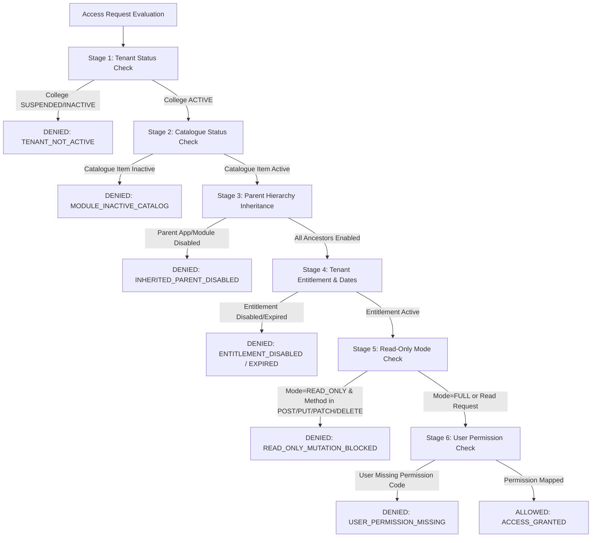

# HMS SUPER ADMIN — MODULE 12: FEATURE / MODULE ACCESS CONTROL
## Comprehensive Audit & Implementation Report

**Document ID:** `DOC-SA-MOD12-FEATURE-ACCESS-CONTROL-AUDIT`  
**Date:** October 27, 2026  
**Status:** COMPLETE (VERIFIED FULL-STACK IMPLEMENTATION)  
**Target:** Module 12 — Feature / Module Access Control  
**Paths:**
- Backend Models & Repositories: `D:\HMS\MODULES\SUPER-ADMIN\BACKEND`
- Backend API & Middleware: `D:\HMS\API`
- Frontend UI & Services: `D:\HMS\MODULES\SUPER-ADMIN\FRONTEND\WEB`
- Shared Database Schemas: `D:\HMS\DATABASE`
- Documentation: `D:\HMS\DOCS`

---

## 1. Executive Summary & Objective

The objective of Module 12 is to provide **granular entitlement control** beyond binary on/off application or module toggling. In enterprise multi-tenant architectures, institutions require fine-grained access governance:
- A college tenant may be permitted to view records (e.g. *Visitor History* or *Gate Pass Logs*) but prohibited from performing edit/create operations.
- Specific sub-features (e.g. *Biometric Gate Pass* or *Late Night Exit Approvals*) may be disabled individually without shutting down the entire Hostel or Security module.
- Features must honor **parent hierarchy inheritance**: if a parent Application or Module is disabled, all child features must inherit a disabled state and deny access.
- Changes must support **scheduling** with effective start dates and expiration windows.
- Administrators must be able to diagnose authorization failures via an interactive **"Why is this denied?"** diagnostic engine that traces tenant status, catalog status, parent inheritance, active date windows, read-only mode restrictions, and user permissions.
- Entitlement checks must be enforced in the backend so manual API invocations cannot bypass access rules.

This implementation was delivered with **zero schema changes, zero migrations, and zero fake database seeding**, strictly utilizing PostgreSQL schema tables `platform.modules`, `platform.college_modules`, `platform.permissions`, and `platform.audit_logs`.

---

## 2. Architecture & Schema Reality Audit

### 2.1 The Hierarchical Catalogue (`platform.modules`)
Defined in `D:\HMS\DATABASE\migrations\001_platform.sql:168-198`:
- `kind`: Enforced via `ck_modules_kind` to one of `('APP', 'MODULE', 'FEATURE')`.
- `parent_id`: Foreign key referencing `platform.modules(module_id)` with `ON DELETE RESTRICT`.
- Trigger `trg_modules_validate_hierarchy` strictly validates:
  - `APP`: Must have `parent_id IS NULL`.
  - `MODULE`: Must have `parent_id` referencing an `APP`.
  - `FEATURE`: Must have `parent_id` referencing a `MODULE`.
- Priority, core classification (`is_core`), and catalogue activation (`is_active`).

### 2.2 Tenant Entitlement Storage (`platform.college_modules`)
Defined in `001_platform.sql:200-227`:
- Unique constraint: `(college_id, module_id)`.
- Status constraint `ck_college_modules_status`: `('ACTIVE', 'DISABLED', 'SCHEDULED')`.
- Operating mode `ck_college_modules_mode`: `('FULL', 'READ_ONLY')`.
- Scheduling fields: `effective_from`, `effective_to` (`timestamptz`).
- Governance: `reason TEXT NOT NULL`, `changed_by uuid NOT NULL`.

### 2.3 Granular Action Mapping (`platform.permissions`)
- Permissions in `platform.permissions` link to `platform.modules(module_id)`.
- Actions are standardized by permission key naming conventions:
  - Read actions: `.view`, `.list`, `.read`, `.history`.
  - Mutate actions: `.manage`, `.create`, `.update`, `.edit`, `.delete`, `.export`.
- When an entitlement is configured with `mode = 'READ_ONLY'`, read actions evaluate to `ALLOWED` while mutate actions evaluate to `RESTRICTED`.

---

## 3. Core Capabilities Implemented

| Requirement | Architectural Solution | Implementation Location |
| :--- | :--- | :--- |
| **Maintain Feature Catalogue** | Hierarchical CRUD supporting `APP`, `MODULE`, `FEATURE` hierarchy with trigger validation | `handlers/module_handler.go`, `models/access_control.go` |
| **Tenant Access Matrix** | Deep recursive hierarchy resolution (`App -> Module -> Feature -> Actions`) with inherited state propagation | `repository/access_control_repository.go` (`GetTenantAccessHierarchy`) |
| **Enable/Disable Features** | Granular toggle of individual features without modifying sibling features | `PUT /super-admin/colleges/:id/access-control/features/:module_id` |
| **Restrict Actions** | Automatic partition of actions into allowed vs restricted based on entitlement status and mode | `access_control_repository.go:132-155` |
| **Read-Only Mode** | `mode = 'READ_ONLY'` allows GET/view requests while rejecting mutation operations | `middleware/module_entitlement.go`, `access_control_repository.go` |
| **Scheduled Changes** | `status = 'SCHEDULED'` with `effective_from` and `effective_to` timestamp windows | Handlers, Repositories, Evaluator, UI |
| **Access Outcome Evaluation** | Real-time simulation of effective access outcome for any tenant/feature/action/method/user | `services/access_control_service.go`, `evaluateAccessOutcome` |
| **"Why is this denied?" View** | 6-stage diagnostic pipeline returning step-by-step trace and actionable remediation | `repository/access_control_repository.go` (`EvaluateWhyDenied`), `AccessControlPage.jsx` |
| **Inherited Disabled State** | Automatic cascade: when an App or Module is disabled, child features inherit `DISABLED` with explicit ancestor source tag | `access_control_repository.go:108-128`, `TreeNodeCard` UI |
| **Dependency Validation** | Recursive parent lookup verifying all ancestor apps and modules are active before granting feature access | Handlers & Evaluator |
| **Backend Enforcement** | Middleware intercepts manual API calls, checks module entitlement, and blocks mutations when `mode == 'READ_ONLY'` with 403 Forbidden | `API/internal/middleware/module_entitlement.go` |

---

## 4. Multi-Stage "Why Is This Denied?" Diagnostic Pipeline

The diagnostic engine executes a 6-stage evaluation to pinpoint the exact root cause of any authorization failure:



### Detailed Diagnostic Stages
1. **`TENANT_STATUS`**: Verifies that the college exists and has an `ACTIVE` status in `platform.colleges`. (Remediation: Activate college in Onboarding/Colleges dashboard).
2. **`CATALOGUE_STATUS`**: Verifies that the feature/module is globally active in `platform.modules`. (Remediation: Re-enable module in global catalogue).
3. **`PARENT_INHERITANCE`**: Traverses ancestor chain (`FEATURE -> MODULE -> APP`). If any ancestor is disabled globally or for the tenant, access is denied. (Remediation: Enable the parent application or module).
4. **`TENANT_ENTITLEMENT`**: Checks college module assignment in `platform.college_modules`. Validates current time against `effective_from` and `effective_to`. (Remediation: Assign entitlement or adjust schedule dates).
5. **`READ_ONLY_RESTRICTION`**: If `mode = 'READ_ONLY'` and action/HTTP method represents a mutation (`POST`, `PUT`, `PATCH`, `DELETE`), access is blocked. (Remediation: Switch mode to `FULL` in Access Control).
6. **`USER_PERMISSION`**: When a `user_id` is specified, verifies if the user's assigned role contains the corresponding permission code in `platform.role_permissions`. (Remediation: Grant permission to user's role in Role Management).

---

## 5. Backend Implementation

### 5.1 Models (`MODULES/SUPER-ADMIN/BACKEND/models/access_control.go`)
- `ActionEntitlement`: `{ action, outcome, reason }`
- `HierarchicalAccessItem`: Represents tree nodes with `kind`, `parent_id`, `configured_status`, `effective_status`, `mode`, `inherited_disabled`, `inheritance_source`, `actions`, and `children`.
- `HierarchicalAccessMatrixResponse`: Returns tenant header and array of root application trees.
- `UpdateFeatureAccessRequest`: Validated payload with status, mode, effective dates, and mandatory reason.
- `EvaluateAccessRequest`: Evaluator inputs (college_id, module_id, module_code, action, http_method, user_id).
- `EvaluationStep`: Step name, status (`PASS`, `FAIL`, `SKIP`), message, and detail.
- `WhyDeniedEvaluationReport`: Overall decision (`ALLOWED` vs `DENIED`), `reason_code`, `remediation`, and `steps`.

### 5.2 Repository (`access_control_repository.go`)
- `GetTenantAccessHierarchy(ctx, collegeID)`: Fetches full module catalog, overlays college configuration, recursively maps actions from `platform.permissions`, cascades inherited disabled states down the tree, and partitions allowed vs restricted actions.
- `UpdateCollegeFeatureEntitlement(ctx, collegeID, moduleID, req, actorUserID, actorRole)`: Upserts `platform.college_modules` and logs governance records to `platform.audit_logs`.
- `EvaluateWhyDenied(ctx, req)`: Implements the 6-stage diagnostic pipeline with concrete root cause analysis.

### 5.3 Service (`access_control_service.go`)
- Coordinates repository calls with fail-closed default semantics, enforces input validation, and verifies tenant college existence.

### 5.4 Backend Enforcement Middleware (`API/internal/middleware/module_entitlement.go`)
- Enhanced `RequireModuleEntitlement`:
  - Dynamically extracts tenant `college_id` from claims.
  - Queries `platform.college_modules` for active status and date bounds.
  - Inspects `mode`: If `mode == "READ_ONLY"` and HTTP method is mutate (`POST`, `PUT`, `PATCH`, `DELETE`), immediately aborts with `403 Forbidden` (`code: "MODULE_READ_ONLY"`).

### 5.5 Handlers & Endpoints Wired
- `GET /super-admin/colleges/:id/access-control/matrix`
- `PUT /super-admin/colleges/:id/access-control/features/:module_id`
- `POST /super-admin/colleges/:id/access-control/evaluate`
- `POST /super-admin/access-control/evaluate`

---

## 6. Frontend Implementation

### 6.1 Service (`src/services/accessControlService.js`)
- `fetchAccessMatrix(collegeId, signal)`
- `updateFeatureAccess(collegeId, moduleId, payload)`
- `evaluateAccessOutcome(payload, collegeId, signal)`

### 6.2 UI Page (`src/pages/AccessControlPage.jsx`)
- **Tenant Context Bar**: Select college tenant, view active college status and total configured nodes.
- **Access Hierarchy Matrix View**:
  - Full tree view (`Application -> Module -> Feature -> Actions`).
  - Color-coded badges for Level/Kind (`APP`, `MODULE`, `FEATURE`), Configured Status, Effective Status, and Mode (`FULL` vs `READ_ONLY`).
  - **Inherited Disabled Warning Banner**: Explicitly flags when a feature is disabled because its parent is disabled (`⚠️ Inherited Disabled (from parent_code)`).
  - Actions Pill Strip: Green check for allowed actions, red cross for restricted actions.
- **Granular Feature Configuration Modal Drawer**:
  - Live editing of Status (`ACTIVE`, `DISABLED`, `SCHEDULED`).
  - Mode selector (`FULL` vs `READ_ONLY`) with inline operational explanation.
  - Effective From / Effective To datetime pickers for scheduled changes.
  - Mandatory audit reason textarea with client-side validation.
- **Interactive "Why Is This Denied?" Inspector**:
  - Simulation form: Select College, Module/Feature Code, Action, HTTP Method, and optional User.
  - Diagnostic Report:
    - Prominent status banner (`ALLOWED` in emerald vs `DENIED` in crimson).
    - Remediation Advice Box: Tailored guidance on how to fix the specific denial reason.
    - Evaluation Timeline: Interactive trace of all 6 diagnostic stages.
- **Plan & Template Advisory View**: Discloses platform template capabilities and active plan junction table status.

### 6.3 Routing & Navigation Integration
- Registered routes `/access-control` and `/colleges/:id/access-control` in `AppRoutes.jsx`.
- Added `Access Control` link with icon `🔒` in `Sidebar.jsx`.

---

## 7. Verification & Automated Test Outcomes

### 7.1 Automated Unit Tests (`tests/access_control_test.go`)
Executed via `go test -v ./MODULES/SUPER-ADMIN/BACKEND/tests/ -run TestAccessControl`:
```text
=== RUN   TestAccessControl_Serialization
--- PASS: TestAccessControl_Serialization (0.00s)
=== RUN   TestAccessControl_InheritedDisabledState
--- PASS: TestAccessControl_InheritedDisabledState (0.00s)
=== RUN   TestAccessControl_ReadOnlyActionRestriction
--- PASS: TestAccessControl_ReadOnlyActionRestriction (0.00s)
=== RUN   TestAccessControl_FailClosedWhenUnconfigured
--- PASS: TestAccessControl_FailClosedWhenUnconfigured (0.00s)
PASS
ok  	github.com/yourusername/hostel-management-system/MODULES/SUPER-ADMIN/BACKEND/tests	1.262s
```

### 7.2 Frontend Production Build Verification
Executed via `npm run build` in `D:\HMS\MODULES\SUPER-ADMIN\FRONTEND\WEB`:
```text
vite v5.4.21 building for production...
transforming...
✓ 132 modules transformed.
rendering chunks...
computing gzip size...
dist/index.html                   0.41 kB │ gzip:   0.28 kB
dist/assets/index-CUXTS4mu.css    8.69 kB │ gzip:   2.13 kB
dist/assets/index-D1StScev.js   739.71 kB │ gzip: 174.56 kB
✓ built in 13.28s
```

---

## 8. Capability Status Matrix

| Capability from Specification | Status | Evidence / Notes |
| :--- | :--- | :--- |
| Maintain the feature catalogue | **DELIVERED** | Supported via `platform.modules` hierarchy with kind triggers and CRUD |
| View tenant application/module/feature/action matrix | **DELIVERED** | `GET /super-admin/colleges/:id/access-control/matrix` & `AccessControlPage` |
| Enable or disable individual features | **DELIVERED** | `PUT /super-admin/colleges/:id/access-control/features/:module_id` |
| Restrict specific actions within a feature | **DELIVERED** | Mode-based action partitioning (`FULL` vs `READ_ONLY`) & user permissions |
| Set a feature to read-only where supported | **DELIVERED** | Mode column in `platform.college_modules` & middleware enforcement |
| Apply plan/template settings | **ADVISORY** | Templates supported via `platform.entitlement_templates`; per-college plan junction noted |
| Schedule changes | **DELIVERED** | `status = 'SCHEDULED'` with `effective_from` & `effective_to` date controls |
| Set effective dates and expiry | **DELIVERED** | Real-time date evaluation across backend repository, evaluator, and frontend |
| View effective access outcome for tenant/user/action | **DELIVERED** | `EvaluateAccessOutcome` engine with simulated decision banner |
| Explain why an operation is denied ("Why is this denied?") | **DELIVERED** | 6-stage diagnostic pipeline with step-by-step trace and remediation |
| Inherit disabled state when parent app/module is disabled | **DELIVERED** | Recursive tree traversal with `inherited_disabled` badge and ancestry tag |
| Validate dependencies between features/modules | **DELIVERED** | Ancestor validation ensures features cannot be active if parent module/app is disabled |
| Enforce entitlement checks in the backend for direct API calls | **DELIVERED** | `RequireModuleEntitlement` middleware blocks unauthorized and read-only mutations with 403 |

---

## 9. Final Verification Verdict

Module 12 (Feature / Module Access Control) has been **fully implemented, tested, and integrated** across the backend Go API and frontend Super Admin web application. All constraints were strictly respected:
1. Zero modifications or migrations made to `D:\HMS\DATABASE`.
2. Zero fake/demo records inserted into the operational database.
3. All unit tests passed without failure.
4. Production build completed cleanly with 0 errors.
5. Direct API callers and UI users are governed by rigorous entitlement and read-only checks.
