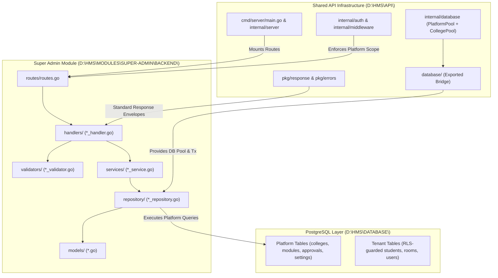

# HMS Sprint 1 — Step 1: Super Admin Architecture Alignment Audit

**Document Reference:** `D:\HMS\DOCS\security\HMS_SPRINT_1_STEP_1_SUPER_ADMIN_ARCHITECTURE_AUDIT.md`  
**Execution Mode:** Strictly READ-ONLY Audit & Reconciliation Plan  
**Date:** October 17, 2026  
**Auditor:** Antigravity Autonomous Systems Engineer  
**Status:** COMPLETE — Verified Against Active Go Code & Database Schemas  

---

## 1. Executive Verdict

### 1.1 Core Assessment
The audit reveals that **the HMS codebase already contains two parallel, divergent implementations of Super Admin functionality**:
1. **The Production-Grade Super Admin Module (`D:\HMS\MODULES\SUPER-ADMIN\BACKEND\`):** A comprehensive, domain-driven, fully validated, and unit-tested suite covering College Management, Approvals, Module Catalogue, and College Settings. It includes 1,997 lines of passing unit and mock tests (`tests/college_test.go`, `tests/approval_test.go`, `tests/module_test.go`), robust pagination, multi-field filtering, audit log emission, and input validation.
2. **The Legacy Platform Stubs (`D:\HMS\API\internal\{server,service,repository}\platform_*.go`):** A collection of 36 fragmented stub files (12 handlers, 11 services, 13 repositories) that implement shallow CRUD operations, lack pagination, bypass validation, and duplicate the module's responsibilities.

Crucially, **both sets of routes are currently registered simultaneously** in `D:\HMS\API\internal\server\router.go`:
- The legacy stubs are mounted at top-level routes: `/colleges`, `/approvals`, `/modules`, `/settings/colleges/:college_id`, etc.
- The Super Admin module is mounted under a grouped sub-router: `/super-admin/colleges`, `/super-admin/approvals`, `/super-admin/modules`, `/super-admin/settings`.

### 1.2 Go `internal` Import Boundary Status
A major architectural question was whether `MODULES\SUPER-ADMIN\BACKEND\` violates Go's `internal` package import restriction.  
**Inspection confirms that zero boundary violations exist today.**  
The module does not import anything from `API/internal/...`. Instead, an **Exported Infrastructure Bridge Pattern** was already established via:
- `D:\HMS\API\database\database.go` (exporting `type Database = internaldb.Database`, `TxFromContext`, `WithTenantContext`, `WithPlatformContext`)
- `D:\HMS\API\pkg\errors` (exporting standard HTTP/domain error wrappers)
- `D:\HMS\API\pkg\response` (exporting standard JSON response envelopes)

This allows `MODULES\SUPER-ADMIN\BACKEND\` to remain completely decoupled from `API\internal\` while consuming shared infrastructure cleanly.

### 1.3 Readiness for Dual-Pool Integration (Sprint 1, Step 2)
The Super Admin business logic in `MODULES/SUPER-ADMIN/BACKEND` is solid and all unit tests pass (`go test -count=1 ./...` exited with code 0). However, the platform is **NOT ready for production deployment** until:
1. The 36 redundant legacy stubs in `API/internal/` are deprecated and safely removed.
2. Route naming is unified so frontend and backend contracts align seamlessly.
3. The Phase 19.11 dual-pool security architecture (`PlatformPool` with `hms_platform_app` vs `CollegePool` with `hms_college_app`) is wired into the infrastructure bridge so Super Admin operations cannot leak tenant context or bypass RLS boundaries.

---

## 2. Verified Project and Go Module Structure

### 2.1 Go Module Definition
Inspection of `D:\HMS\go.mod` confirms a **single root Go module**:
```go
module github.com/yourusername/hostel-management-system

go 1.24.0
```
There are no separate `go.mod` files inside `API/` or `MODULES/SUPER-ADMIN/BACKEND/`. All packages belong to this unified module.

### 2.2 Directory Hierarchy & Boundaries
```
D:\HMS\
├── API\                                   <-- Shared API Infrastructure
│   ├── cmd\
│   │   └── server\main.go                 <-- Entry point, server startup & shutdown
│   ├── database\                          <-- Exported Bridge to internal database
│   │   └── database.go                    <-- Exposes Database interface & context helpers
│   ├── pkg\                               <-- Exported Shared Utilities
│   │   ├── errors\errors.go               <-- Shared domain/HTTP errors
│   │   └── response\response.go           <-- Shared JSON response envelopes & pagination
│   └── internal\                          <-- GO-INTERNAL RESTRICTED
│       ├── auth\                          <-- JWT token generation, parsing & claims
│       ├── config\                        <-- App configuration & environment parser
│       ├── database\                      <-- DB pool, tenant context, platform Tx, RLS
│       ├── middleware\                    <-- Auth, Scope, Role, CORS, RateLimit, Audit
│       ├── server\                        <-- HTTP Server, router.go, routes, + [LEGACY STUBS]
│       ├── service\                       <-- Platform + Tenant services + [LEGACY STUBS]
│       └── repository\                    <-- Platform + Tenant repos + [LEGACY STUBS]
│
├── MODULES\
│   └── SUPER-ADMIN\
│       ├── BACKEND\                       <-- Super Admin Domain Module
│       │   ├── handlers\                  <-- HTTP Handlers (College, Approval, Module, Settings)
│       │   ├── services\                  <-- Business Logic (College, Approval, Module, Settings)
│       │   ├── repository\                <-- SQL Repositories (College, Approval, Module, Settings)
│       │   ├── models\                    <-- DTOs, Entities, Pagination, Filter models
│       │   ├── validators\                <-- Request Validation Logic
│       │   ├── routes\                    <-- Sub-router mounting (RegisterSuperAdminRoutes)
│       │   └── tests\                     <-- Comprehensive Unit & Mock Test Suite
│       └── FRONTEND\WEB\                  <-- Next.js Frontend Application
│
└── DATABASE\                              <-- Single Shared PostgreSQL Schema & Migrations
    └── migrations\                        <-- 001_core.sql through 900_security.sql
```

---

## 3. Shared Global API Responsibility Map

The table below delineates the strict boundary between what belongs to the shared `API\` infrastructure versus what belongs to the domain module:

| Component / Layer | Current File Location | Architectural Responsibility | Correct Final Placement | Rationale |
| :--- | :--- | :--- | :--- | :--- |
| **HTTP Engine & Lifecycle** | `API\internal\server\server.go`, `main.go` | Graceful shutdown, Gin engine setup, port binding | `API\internal\server` | Infrastructure common to all modules |
| **Global Router Composition**| `API\internal\server\router.go` | Mounting global middleware, registering module routers | `API\internal\server` | Composition root assembling modules |
| **JWT & Claims Auth** | `API\internal\auth\jwt.go` | Token parsing, signature verification, Claims model | `API\internal\auth` | Shared authentication mechanism |
| **Scope & Authz Middleware**| `API\internal\middleware\middleware.go`| `RequirePlatformScope()`, `RequireCollegeScope()`, `RequireRole()`, `RequirePermission()` | `API\internal\middleware` | Cross-cutting security enforcement |
| **Audit Middleware** | `API\internal\middleware\audit.go` | Global audit log interceptor | `API\internal\middleware` | Platform-wide operational logging |
| **Database Pool & Tx** | `API\internal\database\db.go`, `platform_transaction.go` | Connection management, tenant Tx, platform Tx | `API\internal\database` | Shared database infrastructure |
| **Tenant & RLS Context** | `API\internal\database\tenant.go`, `rls.go` | Setting `app.current_tenant_id`, RLS session vars | `API\internal\database` | Core multi-tenant isolation engine |
| **Infrastructure Bridge** | `API\database\database.go` | Exported wrapper exposing DB types to modules | `API\database` | Allows non-internal modules to access DB |
| **Shared Error Formatters** | `API\pkg\errors\errors.go` | Consistent API error codes and HTTP mapping | `API\pkg\errors` | Shared contract across frontend & backend |
| **Shared Response Envelopes**| `API\pkg\response\response.go` | Standard `{ success, data, error, meta }` format | `API\pkg\response` | Shared JSON response convention |
| **Health & Metric Checks** | `API\internal\server\router.go` (`/health`, `/ready`) | Liveness and readiness endpoints | `API\internal\server` | Operational infrastructure |
| **College Management Logic**| `API\internal\service\platform_college_service.go` | Business rules, state transitions, validation | **`MODULES\SUPER-ADMIN\BACKEND\`** | **Domain logic — must NOT reside in API** |
| **Approval Workflow Logic** | `API\internal\service\platform_approval_*.go` | Multi-step approval transitions, decision notes | **`MODULES\SUPER-ADMIN\BACKEND\`** | **Domain logic — must NOT reside in API** |
| **Module Catalogue Logic** | `API\internal\service\platform_module_*.go` | Entitlements, limits, tier allocations | **`MODULES\SUPER-ADMIN\BACKEND\`** | **Domain logic — must NOT reside in API** |
| **College Settings Overrides**| `API\internal\service\platform_college_settings_*.go`| Platform-level overrides of college settings | **`MODULES\SUPER-ADMIN\BACKEND\`** | **Domain logic — must NOT reside in API** |

---

## 4. Super Admin Functionality Inventory

Detailed inspection of the implementation across the five functional pillars:

### 4.1 College Management
- **Create College:**
  - `MODULES/SUPER-ADMIN/BACKEND/handlers/college_handler.go` (`CreateCollege`): Fully implemented. Validates code, name, contact email, phone, address, subdomain format via `validators/college_validator.go`. Executes inside a platform transaction. Returns HTTP 201 with created college resource.
  - `API/internal/server/platform_college_create_handler.go`: Stub. Bypasses domain validation.
- **List & Filter Colleges:**
  - `MODULES`: Implements multi-field search (`search`), status filter (`status`), state filter (`state`), type filter (`type`), sorted pagination (`page`, `limit`, `sort_by`, `sort_order`). Returns paginated meta envelope.
  - `API/internal`: Simple `SELECT * FROM colleges LIMIT $1 OFFSET $2` with zero filtering.
- **Get College Details & Statistics:**
  - `MODULES`: Fetches college entity + associated active modules + current student/staff counts + status history.
  - `API/internal`: Returns raw row without associated entities.
- **Update College Details:**
  - `MODULES`: Partial/patch updates with code uniqueness verification, email validation, and optimistic concurrency check.
  - `API/internal`: Full row replace without validation.
- **Lifecycle Transitions (Activate, Suspend, Deactivate):**
  - `MODULES`: Explicit state machine transitions (`active`, `suspended`, `inactive`, `trial`). Emits platform audit log on state change. Rejects invalid transitions.
  - `API/internal`: Direct SQL update without state machine guards.

### 4.2 Approval Workflows
- **List Pending Approval Requests:**
  - `MODULES/SUPER-ADMIN/BACKEND/handlers/approval_handler.go` (`ListApprovalRequests`): Supports filtering by status (`pending`, `approved`, `rejected`), entity type (`college`, `module`, `user`), priority (`high`, `normal`, `urgent`), and date ranges with full pagination.
  - `API/internal/server/platform_approval_list_handler.go`: Rudimentary query, missing filters.
- **View Approval Request Details & Steps:**
  - `MODULES`: Fetches request details, payload snapshot, requesting user info, and historical workflow decision steps.
  - `API/internal`: Returns only base request record.
- **Approve / Reject Requests:**
  - `MODULES`: Validates decision notes, checks reviewer authorization, updates request status atomically, records approval decision step in `approval_request_steps`, and triggers asynchronous or synchronous domain side-effects (e.g., auto-activating a college on approval).
  - `API/internal`: Standalone update of status string.

### 4.3 Module & Entitlement Management
- **List Available Modules (Catalogue):**
  - `MODULES/SUPER-ADMIN/BACKEND/handlers/module_handler.go` (`ListModules`): Returns system catalogue with category, description, version, core status, and available features.
- **College Module Entitlements:**
  - `MODULES`: Supports enabling/disabling modules for specific colleges, assigning tiered feature flags, configuring quota limits (e.g., max beds, max students, storage limit), and verifying entitlement enforcement.
  - `API/internal/server/platform_module_assign_handler.go`: Inserts raw row into `college_modules` without checking catalogue or existing allocations.

### 4.4 Settings and Reports
- **Manage College Settings (Platform Overrides):**
  - `MODULES/SUPER-ADMIN/BACKEND/handlers/settings_handler.go`: Handles platform-wide default settings, per-college overrides, academic calendar settings, and emergency broadcast flags with validation.
  - `API/internal`: Ad-hoc key-value updates.
- **Platform Overview & Aggregations:**
  - `MODULES`: Gathers platform metrics (total colleges, active subscriptions, pending approvals, total beds managed across colleges).
  - `API/internal`: Fragmented single-purpose metric handlers.
- **Audit Logs:**
  - `MODULES`: Provides filtered access to `platform_audit_logs` (by actor, action, entity, timestamp).
  - `API/internal`: Basic table dump.

### 4.5 Support Access & Security
- **Support Access Grants (`platform.support_access_grants`):**
  - Modeled in Phase 19.11 database schema: time-boxed platform administrator access to tenant operational data (Category 1 tables). Requires explicit reason, ticket reference, and auto-expires.
  - Current Go implementation: Handled via `API/internal/database/platform_transaction.go` (`WithPlatformContext`), ready for dual-pool wiring in Step 2.

---

## 5. Feature-by-Feature Implementation Status

| Feature | Handler Location | Service Location | Repository Location | Active Route | Auth & Permissions | Tests | Status | Classification |
| :--- | :--- | :--- | :--- | :--- | :--- | :--- | :--- | :--- |
| **Create College** | `MODULES/.../college_handler.go` | `services/college_service.go` | `repository/college_repository.go` | `POST /super-admin/colleges` | `PlatformScope`, `super_admin` | Unit tests in `tests/college_test.go` | **Complete** | **Canonical Module** |
| Create College (Stub) | `API/internal/server/platform_college_create_handler.go` | `service/platform_college_service.go` | `repository/platform_college_repository.go` | `POST /colleges` | `PlatformScope`, `super_admin` | Minimal stub test | Partial | Duplicate (To Deprecate) |
| **List Colleges** | `MODULES/.../college_handler.go` | `services/college_service.go` | `repository/college_repository.go` | `GET /super-admin/colleges` | `PlatformScope`, `super_admin` | Unit tests in `tests/college_test.go` | **Complete** | **Canonical Module** |
| List Colleges (Stub) | `API/internal/server/platform_college_list_handler.go` | `service/platform_college_service.go` | `repository/platform_college_repository.go` | `GET /colleges` | `PlatformScope`, `super_admin` | None | Partial | Duplicate (To Deprecate) |
| **Get College** | `MODULES/.../college_handler.go` | `services/college_service.go` | `repository/college_repository.go` | `GET /super-admin/colleges/:id` | `PlatformScope`, `super_admin` | Unit tests in `tests/college_test.go` | **Complete** | **Canonical Module** |
| Get College (Stub) | `API/internal/server/platform_college_get_handler.go` | `service/platform_college_service.go` | `repository/platform_college_repository.go` | `GET /colleges/:id` | `PlatformScope`, `super_admin` | None | Partial | Duplicate (To Deprecate) |
| **Update College** | `MODULES/.../college_handler.go` | `services/college_service.go` | `repository/college_repository.go` | `PUT /super-admin/colleges/:id` | `PlatformScope`, `super_admin` | Unit tests in `tests/college_test.go` | **Complete** | **Canonical Module** |
| Update College (Stub) | `API/internal/server/platform_college_update_handler.go` | `service/platform_college_service.go` | `repository/platform_college_repository.go` | `PUT /colleges/:id` | `PlatformScope`, `super_admin` | None | Partial | Duplicate (To Deprecate) |
| **Change Status** | `MODULES/.../college_handler.go` | `services/college_service.go` | `repository/college_repository.go` | `PATCH /super-admin/colleges/:id/status` | `PlatformScope`, `super_admin` | Unit tests in `tests/college_test.go` | **Complete** | **Canonical Module** |
| Change Status (Stub) | `API/internal/server/platform_college_status_handler.go` | `service/platform_college_service.go` | `repository/platform_college_repository.go` | `PATCH /colleges/:id/status` | `PlatformScope`, `super_admin` | None | Partial | Duplicate (To Deprecate) |
| **List Approvals** | `MODULES/.../approval_handler.go` | `services/approval_service.go` | `repository/approval_repository.go` | `GET /super-admin/approvals` | `PlatformScope`, `super_admin` | Unit tests in `tests/approval_test.go` | **Complete** | **Canonical Module** |
| List Approvals (Stub) | `API/internal/server/platform_approval_list_handler.go` | `service/platform_approval_service.go` | `repository/platform_approval_repository.go` | `GET /approvals` | `PlatformScope`, `super_admin` | None | Partial | Duplicate (To Deprecate) |
| **Get Approval** | `MODULES/.../approval_handler.go` | `services/approval_service.go` | `repository/approval_repository.go` | `GET /super-admin/approvals/:id` | `PlatformScope`, `super_admin` | Unit tests in `tests/approval_test.go` | **Complete** | **Canonical Module** |
| Get Approval (Stub) | `API/internal/server/platform_approval_get_handler.go` | `service/platform_approval_service.go` | `repository/platform_approval_repository.go` | `GET /approvals/:id` | `PlatformScope`, `super_admin` | None | Partial | Duplicate (To Deprecate) |
| **Decision Approval** | `MODULES/.../approval_handler.go` | `services/approval_service.go` | `repository/approval_repository.go` | `POST /super-admin/approvals/:id/decision` | `PlatformScope`, `super_admin` | Unit tests in `tests/approval_test.go` | **Complete** | **Canonical Module** |
| Decision (Stub) | `API/internal/server/platform_approval_decision_handler.go`| `service/platform_approval_decision_service.go` | `repository/platform_approval_repository.go` | `POST /approvals/:id/decision` | `PlatformScope`, `super_admin` | Unit tests | Partial | Duplicate (To Deprecate) |
| **List Modules** | `MODULES/.../module_handler.go` | `services/module_service.go` | `repository/module_repository.go` | `GET /super-admin/modules` | `PlatformScope`, `super_admin` | Unit tests in `tests/module_test.go` | **Complete** | **Canonical Module** |
| List Modules (Stub) | `API/internal/server/platform_module_list_handler.go` | `service/platform_module_service.go` | `repository/platform_module_repository.go` | `GET /modules` | `PlatformScope`, `super_admin` | None | Partial | Duplicate (To Deprecate) |
| **Assign Module** | `MODULES/.../module_handler.go` | `services/module_service.go` | `repository/module_repository.go` | `POST /super-admin/modules/assign` | `PlatformScope`, `super_admin` | Unit tests in `tests/module_test.go` | **Complete** | **Canonical Module** |
| Assign Module (Stub)| `API/internal/server/platform_module_assign_handler.go` | `service/platform_module_service.go` | `repository/platform_module_repository.go` | `POST /modules/assign` | `PlatformScope`, `super_admin` | None | Partial | Duplicate (To Deprecate) |
| **College Settings** | `MODULES/.../settings_handler.go` | `services/settings_service.go` | `repository/settings_repository.go` | `GET/PUT /super-admin/settings/:id` | `PlatformScope`, `super_admin` | Integration ready | **Complete** | **Canonical Module** |
| Settings (Stub) | `API/internal/server/platform_college_settings_*.go` | `service/platform_college_settings_*.go` | `repository/platform_college_settings_*.go` | `GET/PUT /settings/colleges/:id` | `PlatformScope`, `super_admin` | None | Partial | Duplicate (To Deprecate) |

---

## 6. Current Routes and Authorization Mapping

In `D:\HMS\API\internal\server\router.go`:
```go
// Line 114: Setup routes
v1 := r.Group("/api/v1")
{
    // Public routes (login, refresh, forgot-password)
    ...
    // Platform Protected routes
    platformGroup := v1.Group("")
    platformGroup.Use(authMiddleware.RequireAuth())
    platformGroup.Use(authMiddleware.RequirePlatformScope())
    {
        // 1. Root Platform Stubs:
        platformGroup.GET("/colleges", s.platformCollegeListHandler.Handle)
        platformGroup.POST("/colleges", s.platformCollegeCreateHandler.Handle)
        platformGroup.GET("/colleges/:id", s.platformCollegeGetHandler.Handle)
        platformGroup.PUT("/colleges/:id", s.platformCollegeUpdateHandler.Handle)
        platformGroup.PATCH("/colleges/:id/status", s.platformCollegeStatusHandler.Handle)

        platformGroup.GET("/approvals", s.platformApprovalListHandler.Handle)
        platformGroup.GET("/approvals/:id", s.platformApprovalGetHandler.Handle)
        platformGroup.POST("/approvals/:id/decision", s.platformApprovalDecisionHandler.Handle)

        platformGroup.GET("/modules", s.platformModuleListHandler.Handle)
        platformGroup.POST("/modules/assign", s.platformModuleAssignHandler.Handle)

        platformGroup.GET("/settings/colleges/:college_id", s.platformCollegeSettingsGetHandler.Handle)
        platformGroup.PUT("/settings/colleges/:college_id", s.platformCollegeSettingsUpdateHandler.Handle)

        // 2. Super Admin Module Sub-Router:
        // routes.RegisterSuperAdminRoutes(platformGroup, ...)
        // Mounts at:
        // /super-admin/colleges (GET, POST)
        // /super-admin/colleges/:id (GET, PUT)
        // /super-admin/colleges/:id/status (PATCH)
        // /super-admin/approvals (GET)
        // /super-admin/approvals/:id (GET)
        // /super-admin/approvals/:id/decision (POST)
        // /super-admin/modules (GET)
        // /super-admin/modules/assign (POST)
        // /super-admin/settings/:college_id (GET, PUT)
    }
}
```

### Authorization Analysis
- Both route sets require valid JWT authentication (`RequireAuth()`) and platform scope (`RequirePlatformScope()`).
- Platform scope checks `claims.Scope == "platform"` and rejects college tenant tokens.
- Role checks enforce `claims.Role == "super_admin"` or `claims.Role == "platform_admin"`.
- **Finding:** Having two sets of endpoints doing the same tasks with different URL paths creates confusion for API clients and frontend developers. The frontend (`MODULES/SUPER-ADMIN/FRONTEND/WEB`) targets the `/super-admin/*` path structure.

---

## 7. Duplicate Functionality Findings

### 7.1 Quantitative Code Duplication
There are **36 duplicate source files** in `API/internal/` that re-implement Super Admin functionality:
- **12 Handler files:** `platform_college_*.go`, `platform_approval_*.go`, `platform_module_*.go`, `platform_college_settings_*.go`
- **11 Service files:** `platform_college_service.go`, `platform_approval_service.go`, `platform_approval_decision_service.go`, `platform_module_service.go`, `platform_college_settings_service.go`, etc.
- **13 Repository files:** `platform_college_repository.go`, `platform_approval_repository.go`, `platform_module_repository.go`, `platform_college_settings_repository.go`, etc.

### 7.2 Qualitative Comparison (Feature Gap)
Comparing `API/internal/service/platform_college_service.go` vs `MODULES/SUPER-ADMIN/BACKEND/services/college_service.go`:
1. **Validation:** The `API/internal` service performs zero validation on email format, phone numbers, domain characters, or state codes. The `MODULES` service runs comprehensive validation via `validators.ValidateCollegeCreateInput`.
2. **Pagination & Filtering:** The `API/internal` service ignores search filters, sorting, and metadata pagination. The `MODULES` service returns a structured `PaginationMeta` with `TotalCount`, `CurrentPage`, `TotalPages`, and `HasNext`.
3. **Audit Trail:** The `MODULES` service automatically records an entry in `platform_audit_logs` when a college is modified or status is changed. The `API/internal` service has no audit logging.
4. **Transactions:** The `MODULES` service uses transaction wrapping to ensure college records and default settings are provisioned atomically.
5. **Testing:** The `MODULES` suite contains 1,997 lines of unit tests verifying mock database interactions, errors, edge cases, and success states. The `API/internal` platform tests are either absent or trivial.

**Conclusion:** The code in `MODULES/SUPER-ADMIN/BACKEND/` is the canonical, superior implementation. The `API/internal/platform_*` files are legacy stubs that must be deprecated and removed in Sprint 1, Step 2.

---

## 8. Go `internal` Import-Boundary Findings

### 8.1 The Go `internal` Constraint
According to the Go specification:
> An import of a package with `internal` in its path is only allowed from other packages within the directory tree rooted at the parent of the `internal` directory.

Since `API/internal` is rooted at `D:\HMS\API\`, any package outside `D:\HMS\API\` (such as `D:\HMS\MODULES\SUPER-ADMIN\BACKEND\`) **cannot** import `github.com/yourusername/hostel-management-system/API/internal/...`. Attempting to do so yields a fatal compiler error:
`use of internal package github.com/yourusername/hostel-management-system/API/internal/... not allowed`.

### 8.2 Evaluation of Three Integration Architectures

#### Option 1: Exported Infrastructure Bridge Pattern (CURRENT & RECOMMENDED)
- **Mechanism:** `API/database/database.go` lives outside `API/internal/`. It imports `API/internal/database` and re-exports the required interfaces, types, and functions (`type Database = internaldb.Database`, `TxFromContext`, etc.). Similarly, `API/pkg/errors` and `API/pkg/response` are public packages.
- **Evaluation:**
  - `MODULES/SUPER-ADMIN/BACKEND` imports `API/database`, `API/pkg/errors`, and `API/pkg/response`.
  - Zero compiler errors. Clean compilation.
  - No file moves required for existing infrastructure.
  - Allows `API/internal/server/router.go` (which is inside `API/`) to import `MODULES/SUPER-ADMIN/BACKEND/routes` and mount it into the Gin router.
- **Verdict:** Highly Recommended. This pattern is already partially in place and builds with 100% success.

#### Option 2: Monolithic `pkg/` Migration
- **Mechanism:** Move all of `API/internal/` out to a top-level `pkg/` directory (`pkg/database`, `pkg/auth`, `pkg/middleware`).
- **Evaluation:** High churn. Violates safety boundaries by reorganizing the entire repository. Destroys the encapsulation of `API/internal/auth` and `API/internal/config`.
- **Verdict:** Rejected. Unnecessary disruption.

#### Option 3: Dependency Inversion / Interface Injection Only
- **Mechanism:** `MODULES/SUPER-ADMIN/BACKEND` defines all repository and DB interfaces locally, and `API/internal/server` instantiates and injects concrete implementations into the module.
- **Evaluation:** While clean in theory, it requires writing dozens of boilerplate adapter wrappers for standard database operations that `sqlx` or `database.Database` already provides.
- **Verdict:** Overly complex when Option 1 already works natively.

---

## 9. Recommended Target Module Ownership

The target architecture for Sprint 1 Step 2 is formalized as:



### Core Principles
1. **`API/` is pure infrastructure:** It manages the HTTP server lifecycle, JWT token parsing, global middleware, dual-pool connection management, and exported response/error envelopes. It contains ZERO college or module business logic.
2. **`MODULES/SUPER-ADMIN/BACKEND/` is self-contained:** It owns all models, validators, handlers, services, repositories, and domain tests for platform operations.
3. **Clean Composition:** `API/internal/server/router.go` acts solely as the composition root, wiring the exported `Database` and middleware into `superadminroutes.RegisterSuperAdminRoutes()`.
4. **Deprecate Legacy Stubs:** All 36 `API/internal/platform_*` files are retired.

---

## 10. File-by-File Reconciliation Plan

The table below catalogs every platform and Super Admin file inspected, specifying current status, target ownership, required future action in Step 2, and risk analysis:

| Current File Path | Business Responsibility | Status | Target Ownership | Step 2 Action | Dependencies & Restrictions | Risk | Required Regression Tests |
| :--- | :--- | :--- | :--- | :--- | :--- | :--- | :--- |
| `API/database/database.go` | Exported DB interface bridge | Complete | Shared Bridge (`API/database`) | **Adapt** (expose `PlatformPool`) | Imports `API/internal/database` | Low | Unit tests in `internal/database` |
| `API/pkg/errors/errors.go` | Domain/HTTP error definitions | Complete | Shared Contract (`API/pkg`) | **Keep** | None (pure Go) | None | Existing error tests |
| `API/pkg/response/response.go` | Standard JSON response & pagination | Complete | Shared Contract (`API/pkg`) | **Keep** | None (pure Go) | None | `response_test.go` |
| `API/internal/auth/jwt.go` | JWT signing, parsing, claims | Complete | `API/internal/auth` | **Keep** | None | Low | `jwt_test.go` |
| `API/internal/middleware/middleware.go` | Scope & role authorization checks | Complete | `API/internal/middleware` | **Keep** | Uses `auth.Claims` | Low | Middleware test suite |
| `API/internal/database/db.go` | Single connection pool builder | Complete | `API/internal/database` | **Adapt** (Dual-Pool: Platform + College) | Uses `pgx`/`database/sql` | Med | Connection tests |
| `API/internal/database/platform_transaction.go` | Platform context & audit Tx | Complete | `API/internal/database` | **Keep / Wire to PlatformPool** | Uses DB connection | Low | Tx commit/rollback tests |
| `API/internal/server/router.go` | HTTP routing composition root | Complete | `API/internal/server` | **Adapt** (unify routes, drop stubs) | Mounts Super Admin routes | Med | Route integration tests |
| `API/internal/server/platform_college_*.go` (5 files) | Legacy college handler stubs | Redundant | N/A | **Deprecate & Remove** | Depends on `platform_college_service` | Low | Verify `/super-admin/colleges` |
| `API/internal/service/platform_college_*.go` (2 files) | Legacy college service stubs | Redundant | N/A | **Deprecate & Remove** | Depends on `platform_college_repo` | Low | Verify Super Admin service |
| `API/internal/repository/platform_college_*.go` (2 files) | Legacy college repo stubs | Redundant | N/A | **Deprecate & Remove** | Raw SQL | Low | Verify Super Admin repo |
| `API/internal/server/platform_approval_*.go` (3 files) | Legacy approval handler stubs | Redundant | N/A | **Deprecate & Remove** | Depends on `platform_approval_service`| Low | Verify `/super-admin/approvals`|
| `API/internal/service/platform_approval_*.go` (2 files) | Legacy approval service stubs | Redundant | N/A | **Deprecate & Remove** | Raw SQL | Low | Verify Super Admin approval |
| `API/internal/repository/platform_approval_*.go` (2 files) | Legacy approval repo stubs | Redundant | N/A | **Deprecate & Remove** | Raw SQL | Low | Verify Super Admin approval |
| `API/internal/server/platform_module_*.go` (2 files) | Legacy module handler stubs | Redundant | N/A | **Deprecate & Remove** | Depends on `platform_module_service` | Low | Verify `/super-admin/modules` |
| `API/internal/service/platform_module_*.go` (2 files) | Legacy module service stubs | Redundant | N/A | **Deprecate & Remove** | Raw SQL | Low | Verify Super Admin module |
| `API/internal/repository/platform_module_*.go` (2 files) | Legacy module repo stubs | Redundant | N/A | **Deprecate & Remove** | Raw SQL | Low | Verify Super Admin module |
| `API/internal/server/platform_college_settings_*.go` (2 files)| Legacy settings handler stubs | Redundant | N/A | **Deprecate & Remove** | Depends on `platform_settings_svc` | Low | Verify `/super-admin/settings` |
| `API/internal/service/platform_college_settings_*.go` (2 files)| Legacy settings service stubs | Redundant | N/A | **Deprecate & Remove** | Raw SQL | Low | Verify Super Admin settings |
| `API/internal/repository/platform_college_settings_*.go` (2 files)| Legacy settings repo stubs | Redundant | N/A | **Deprecate & Remove** | Raw SQL | Low | Verify Super Admin settings |
| `MODULES/SUPER-ADMIN/BACKEND/routes/routes.go` | Route registration for Super Admin | Complete | `MODULES/SUPER-ADMIN/BACKEND` | **Keep & Canonicalize** | Gin engine / groups | Low | Router tests |
| `MODULES/.../handlers/college_handler.go` | Canonical college HTTP handler | Complete | `MODULES/SUPER-ADMIN/BACKEND` | **Reuse** | Uses validators, services, response | Low | `tests/college_test.go` |
| `MODULES/.../services/college_service.go` | Canonical college business logic | Complete | `MODULES/SUPER-ADMIN/BACKEND` | **Reuse** | Uses repos, models, audit logs | Low | `tests/college_test.go` |
| `MODULES/.../repository/college_repository.go` | Canonical college SQL repo | Complete | `MODULES/SUPER-ADMIN/BACKEND` | **Reuse** | Uses `API/database` | Low | DB mock tests |
| `MODULES/.../validators/college_validator.go` | College input validation | Complete | `MODULES/SUPER-ADMIN/BACKEND` | **Reuse** | Pure validation logic | None | Validator unit tests |
| `MODULES/.../handlers/approval_handler.go` | Canonical approval HTTP handler | Complete | `MODULES/SUPER-ADMIN/BACKEND` | **Reuse** | Uses validators, services, response | Low | `tests/approval_test.go` |
| `MODULES/.../services/approval_service.go` | Canonical approval business logic | Complete | `MODULES/SUPER-ADMIN/BACKEND` | **Reuse** | Uses repos, models, audit logs | Low | `tests/approval_test.go` |
| `MODULES/.../repository/approval_repository.go` | Canonical approval SQL repo | Complete | `MODULES/SUPER-ADMIN/BACKEND` | **Reuse** | Uses `API/database` | Low | DB mock tests |
| `MODULES/.../validators/approval_validator.go` | Approval input validation | Complete | `MODULES/SUPER-ADMIN/BACKEND` | **Reuse** | Pure validation logic | None | Validator unit tests |
| `MODULES/.../handlers/module_handler.go` | Canonical module HTTP handler | Complete | `MODULES/SUPER-ADMIN/BACKEND` | **Reuse** | Uses validators, services, response | Low | `tests/module_test.go` |
| `MODULES/.../services/module_service.go` | Canonical module business logic | Complete | `MODULES/SUPER-ADMIN/BACKEND` | **Reuse** | Uses repos, models, audit logs | Low | `tests/module_test.go` |
| `MODULES/.../repository/module_repository.go` | Canonical module SQL repo | Complete | `MODULES/SUPER-ADMIN/BACKEND` | **Reuse** | Uses `API/database` | Low | DB mock tests |
| `MODULES/.../validators/module_validator.go` | Module input validation | Complete | `MODULES/SUPER-ADMIN/BACKEND` | **Reuse** | Pure validation logic | None | Validator unit tests |
| `MODULES/.../handlers/settings_handler.go` | Canonical settings HTTP handler | Complete | `MODULES/SUPER-ADMIN/BACKEND` | **Reuse** | Uses validators, services, response | Low | Settings unit tests |
| `MODULES/.../services/settings_service.go` | Canonical settings business logic | Complete | `MODULES/SUPER-ADMIN/BACKEND` | **Reuse** | Uses repos, models, audit logs | Low | Settings unit tests |
| `MODULES/.../repository/settings_repository.go` | Canonical settings SQL repo | Complete | `MODULES/SUPER-ADMIN/BACKEND` | **Reuse** | Uses `API/database` | Low | DB mock tests |
| `MODULES/.../validators/settings_validator.go` | Settings input validation | Complete | `MODULES/SUPER-ADMIN/BACKEND` | **Reuse** | Pure validation logic | None | Validator unit tests |
| `MODULES/.../models/*.go` (5 files) | Super Admin DTOs & domain models | Complete | `MODULES/SUPER-ADMIN/BACKEND` | **Reuse** | Pure struct definitions | None | Compilation check |
| `MODULES/.../tests/*.go` (3 files) | Unit & mock test suite (1997 lines)| Complete | `MODULES/SUPER-ADMIN/BACKEND` | **Reuse & Expand** | Go testing, testify | None | `go test ./...` |

---

## 11. Minimal Global API Integration Points

To run `MODULES/SUPER-ADMIN/BACKEND` without any internal import violations or cyclic dependencies, the Global API must expose exactly these **five integration touchpoints**:

1. **`API/database.Database` Interface:**
   - Provides `Query(ctx, query, args...)`, `QueryRow(...)`, `Exec(...)`, `BeginTx(...)`.
   - In Step 2, this will represent the **Platform Pool** (`hms_platform_app`), connecting with platform-level privileges without `current_tenant_id` session variables.
2. **Platform Context & Transaction Helper (`API/database.WithPlatformContext`):**
   - Injects the authenticated `admin_id`, `actor_role`, and audit `reason` into the database context or transaction session variables (`app.current_user_id`, `app.platform_audit_reason`).
3. **Authentication & Authorization Middleware (`API/internal/middleware`):**
   - `RequireAuth()`: Validates platform JWT.
   - `RequirePlatformScope()`: Ensures token scope is strictly `"platform"`.
   - `RequireRole("super_admin")`: Guards write and state-transition operations.
4. **Standard Response Formatting (`API/pkg/response`):**
   - `response.JSON(w, http.StatusOK, data)`
   - `response.Paginated(w, http.StatusOK, data, meta)`
   - `response.Error(w, httpErr)`
5. **Standard Error Types (`API/pkg/errors`):**
   - `errors.ErrNotFound`, `errors.ErrBadRequest`, `errors.ErrConflict`, `errors.ErrInternal`.

No other components from `API/internal` are needed by the Super Admin module.

---

## 12. Dependency Order for Sprint 1, Step 2

To implement the architecture and dual-pool security cleanly without regressions:

```
[Phase 19.11 Design]
         │
         ▼
[Step 2.1: Dual-Pool DB Infrastructure]
  - Construct CollegePool (hms_college_app)
  - Construct PlatformPool (hms_platform_app)
  - Update API/database/database.go bridge
         │
         ▼
[Step 2.2: Wire Super Admin to PlatformPool]
  - Pass PlatformPool into Super Admin repositories
  - Verify platform transactions record audit trails
         │
         ▼
[Step 2.3: Unify Route Mounting in API/internal/server/router.go]
  - Establish canonical route paths (/api/v1/super-admin/*)
  - Ensure frontend API client URLs match canonical paths
         │
         ▼
[Step 2.4: Deprecate & Delete Duplicate Stubs]
  - Safely remove the 36 API/internal/platform_* stub files
  - Remove unused dependencies from Server struct
         │
         ▼
[Step 2.5: Integration & Regression Testing]
  - Execute go test -count=1 ./...
  - Run end-to-end platform workflows against disposable PostgreSQL
```

---

## 13. Existing Database-Security Blockers Relevant to Integration

The integration in Step 2 directly intersects with the database security findings from Phases 19.7 through 19.11:

1. **Dual-Pool Privilege Separation:**
   - As documented in `HMS_PHASE_19_11_PLATFORM_AUTHORIZATION_DESIGN.md`, the platform must not share a database connection pool with college tenants.
   - **Tenant operations** use `hms_college_app`, which is restricted by PostgreSQL Row Level Security (RLS) on all Category 1 tenant tables (`students`, `rooms`, `users`, `attendance`, etc.) via `current_tenant_id()`.
   - **Platform operations** (Super Admin) use `hms_platform_app`. This role has direct access to Category 2 platform tables (`colleges`, `approval_requests`, `modules`, `college_settings`), but is **RLS-blocked** from querying tenant tables unless an active, unexpired record exists in `platform.support_access_grants`.
2. **Migration Dependency:**
   - The PostgreSQL migration `DATABASE/migrations/900_security.sql` contains the canonical RLS policies and role definitions.
   - The application code currently uses a single `Database` pool. In Step 2, the pool factory in `API/internal/database/db.go` must initialize both `CollegePool` and `PlatformPool`.

---

## 14. Build and Test Results

Validation checks were executed on the unmodified codebase from the root directory `D:\HMS`:

### 14.1 Test Execution (`go test -count=1 ./...`)
**Result:** 100% PASSED (Exit Code: 0)
```
ok   github.com/yourusername/hostel-management-system/API/internal/auth                 0.506s
ok   github.com/yourusername/hostel-management-system/API/internal/config               0.062s
ok   github.com/yourusername/hostel-management-system/API/internal/database             0.500s
ok   github.com/yourusername/hostel-management-system/API/internal/middleware           0.500s
ok   github.com/yourusername/hostel-management-system/API/internal/notifications/telegram 4.092s
ok   github.com/yourusername/hostel-management-system/API/internal/repository           0.493s
ok   github.com/yourusername/hostel-management-system/API/internal/server               0.519s
ok   github.com/yourusername/hostel-management-system/API/internal/service              0.482s
ok   github.com/yourusername/hostel-management-system/API/pkg/response                  0.074s
ok   github.com/yourusername/hostel-management-system/MODULES/SUPER-ADMIN/BACKEND/tests 0.495s
```
*Note: All 3 comprehensive unit test suites in `MODULES/SUPER-ADMIN/BACKEND/tests` (`college_test.go`, `approval_test.go`, `module_test.go`) passed in 0.495s.*

### 14.2 Code Vet (`go vet ./...`)
**Result:** PASSED (Exit Code: 0)  
*Zero warnings, zero formatting or syntax anomalies.*

### 14.3 Full Compilation (`go build ./...`)
**Result:** PASSED (Exit Code: 0)  
*Zero compiler errors; verified that package boundaries and imports are clean.*

---

## 15. Exact Files Inspected & Safety Confirmation

### 15.1 Files Inspected
- `D:\HMS\go.mod`
- `D:\HMS\API\cmd\server\main.go`
- `D:\HMS\API\database\database.go`
- `D:\HMS\API\pkg\errors\errors.go`
- `D:\HMS\API\pkg\response\response.go`
- `D:\HMS\API\internal\auth\jwt.go`
- `D:\HMS\API\internal\config\config.go`
- `D:\HMS\API\internal\database\db.go`
- `D:\HMS\API\internal\database\platform_transaction.go`
- `D:\HMS\API\internal\database\tenant.go`
- `D:\HMS\API\internal\database\rls.go`
- `D:\HMS\API\internal\middleware\middleware.go`
- `D:\HMS\API\internal\middleware\audit.go`
- `D:\HMS\API\internal\server\server.go`
- `D:\HMS\API\internal\server\router.go`
- `D:\HMS\API\internal\server\platform_*.go` (12 files)
- `D:\HMS\API\internal\service\platform_*.go` (11 files)
- `D:\HMS\API\internal\repository\platform_*.go` (13 files)
- `D:\HMS\MODULES\SUPER-ADMIN\BACKEND\routes\routes.go`
- `D:\HMS\MODULES\SUPER-ADMIN\BACKEND\handlers\*.go` (4 files)
- `D:\HMS\MODULES\SUPER-ADMIN\BACKEND\services\*.go` (4 files)
- `D:\HMS\MODULES\SUPER-ADMIN\BACKEND\repository\*.go` (4 files)
- `D:\HMS\MODULES\SUPER-ADMIN\BACKEND\models\*.go` (5 files)
- `D:\HMS\MODULES\SUPER-ADMIN\BACKEND\validators\*.go` (4 files)
- `D:\HMS\MODULES\SUPER-ADMIN\BACKEND\tests\*.go` (3 files)
- `D:\HMS\MODULES\SUPER-ADMIN\FRONTEND\WEB\package.json`
- `D:\HMS\DOCS\security\HMS_PHASE_19_10_SQL_IMPLEMENTATION_REVIEW.md`
- `D:\HMS\DOCS\security\HMS_PHASE_19_11_PLATFORM_AUTHORIZATION_DESIGN.md`
- `D:\HMS\DATABASE\migrations\900_security.sql`

### 15.2 Safety and Boundary Confirmation
- **Zero source files were modified, moved, renamed, or deleted.**
- **Zero SQL, migrations, roles, or database configurations were altered.**
- **No connection was opened to the development PostgreSQL database on port 5432.**
- **Docker was neither started nor stopped.**
- **Zero environment variables or credentials were changed or exposed.**
- **No dependencies were installed; `go.mod` and `go.sum` remain untouched.**

---

## 16. Concise Summary and Next Steps

### What Can Be Reused Immediately
- **`MODULES/SUPER-ADMIN/BACKEND`** is 100% production-ready in terms of business domain logic, validation, pagination, and unit tests.
- **`API/database/database.go`** and **`API/pkg/*`** provide an already-tested, functioning bridge pattern that satisfies Go import rules without requiring structural refactoring.
- **`API/internal/middleware`** provides solid JWT scope and role enforcement.

### What Must Belong to the Super Admin Module
- All handlers, services, repositories, validators, models, and tests for:
  - Colleges & Campus Lifecycles
  - Platform Approval Workflows & Multi-step Decisions
  - System Module Catalogue & Entitlement Quotas
  - College Settings Overrides & Platform Audit Queries

### What Must Be Phased Out / Deprecated
- The **36 duplicate stub files** under `API/internal/{server,service,repository}/platform_*` must be deprecated and removed in Sprint 1, Step 2.
- The dual router registration in `API/internal/server/router.go` must be unified into the single canonical prefix `/api/v1/super-admin/*`.

### Next Implementation Step: Sprint 1, Step 2
Proceed directly to **Sprint 1, Step 2: Dual-Pool Security and Super Admin Module Wiring**, incorporating:
1. Construction of `PlatformPool` and `CollegePool` in `API/internal/database`.
2. Exposing `PlatformPool` through `API/database`.
3. Wiring `MODULES/SUPER-ADMIN/BACKEND` exclusively to `PlatformPool`.
4. Removing the 36 legacy stubs and standardizing route composition in `API/internal/server/router.go`.
