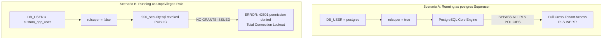

# HMS Phase 19.3–19.4 — Trigger, Role and Security Integration Verification

**Document**: `D:\HMS\DOCS\security\HMS_PHASE_19_3_19_4_VERIFICATION.md`  
**Phase**: 19.3–19.4 — Trigger, Role and Security Integration Verification  
**Date**: 2026-10-17  
**Auditor**: Antigravity Autonomous Security Engineering Subsystem  
**Status**: **VERIFICATION COMPLETE — RUNTIME INTEGRATION ENVIRONMENT BLOCKED**  
**Execution Mode**: Autonomous, strictly read-only inspection. Zero repository files modified, no database migrations executed, no live database roles created or altered.

---

## 1. Executive Summary & Verdict

This Phase 19.3–19.4 audit was conducted to complete the deep verification of database triggers, database application roles, table privileges, and the security integration test suite required to support Phase 19 remediation.

### 1.1 Key Verdicts
1. **Trigger Defects Confirmed (100% Verified)**:
   - `DATABASE/migrations/008_communication.sql:413-422` and `DATABASE/migrations/009_meals_resources.sql:585-593` query `app.users.college_id`.
   - Authoritative schema in `001_platform.sql:94-130` confirms `app.users` has **no `college_id` column**.
   - Invoking these triggers crashes at runtime with PostgreSQL error `42703 (undefined_column)`.
   - The canonical relationship is established via `platform.user_roles` (`user_id`, `college_id`, `status`, `expires_at`).
2. **Database Application Role Defect Confirmed (100% Verified)**:
   - Existing migrations contain **zero** `CREATE ROLE`, zero `CREATE USER`, and zero `GRANT` statements.
   - `900_security.sql:350-375` stripped all table and schema privileges from `PUBLIC`.
   - The application relies on `DB_USER` from environment. If configured as `postgres` (superuser), PostgreSQL **completely bypasses Row-Level Security**, ignoring all tenant policies. If configured as an unprivileged role, the application fails immediately with `42501 (permission_denied)` due to missing grants.
3. **Integration Test Suite Audit**:
   - 2 integration tests exist in `API/internal/repository/tenant_rls_test.go` (`TestTenantRLS_Isolation_Integration` and `TestTenantRLS_PooledConnection_Leakage`).
   - However, existing tests bypass the application service and HTTP layer completely by manually opening transactions and calling `database.SetTenantContext`.
   - 9 out of 11 critical security integration scenarios (including real HTTP handler execution, trigger validation, super-admin platform isolation, rollback on handler failure, and cancellation cleanup) are currently absent.
4. **Runtime Integration Status**:
   - Runtime integration testing is **ENVIRONMENT BLOCKED**. The Docker Desktop daemon is inactive, and `TEST_DATABASE_URL` is unset.
   - Static analysis (`go vet`), compilation (`go build`), and all 28 existing Go unit tests pass cleanly (`Exit Code: 0`).

---

## 2. Part A — Verification of Trigger Defects & Canonical Schema Mapping

### 2.1 Trigger Defect 1: `DATABASE/migrations/008_communication.sql`

#### Trigger Function and Invocation
- **Function Name**: `app.validate_communication_tenant_consistency()` (Lines 363–444)
- **Trigger Name**: `trg_validate_notification_recipients_tenant` (Lines 455–458)
- **Target Table**: `app.notification_recipients`
- **Execution Event**: `BEFORE INSERT OR UPDATE ON app.notification_recipients FOR EACH ROW`

#### Source Inspection (Lines 398–424)
```sql
ELSIF TG_TABLE_NAME = 'notification_recipients' THEN
    SELECT college_id
    INTO related_college_id
    FROM app.notifications
    WHERE id = NEW.notification_id;

    IF related_college_id IS NOT NULL THEN
        IF NOT EXISTS (
            SELECT 1
            FROM app.users u
            WHERE u.user_id = NEW.user_id
              AND u.college_id = related_college_id -- <-- DEFECT: Column does not exist!
        ) THEN
            RAISE EXCEPTION
                'Notification recipient belongs to a different college';
        END IF;
    END IF;
```

#### Authoritative Schema Verification
- In `DATABASE/migrations/001_platform.sql` (Lines 94–130), `app.users` is defined as:
  ```sql
  CREATE TABLE app.users (
      user_id                 uuid PRIMARY KEY DEFAULT gen_random_uuid(),
      email                   citext,
      phone                   varchar(30),
      password_hash           text,
      status                  varchar(30) NOT NULL DEFAULT 'ACTIVE',
      mfa_enabled             boolean NOT NULL DEFAULT false,
      last_login_at           timestamptz,
      created_at              timestamptz NOT NULL DEFAULT now(),
      updated_at              timestamptz NOT NULL DEFAULT now(),
      ...
  );
  ```
- **Finding**: Column `college_id` does NOT exist in `app.users`.
- **Runtime Error**: When inserting into `app.notification_recipients` for a college-scoped notification, PostgreSQL terminates the statement with:
  `ERROR: column u.college_id does not exist (SQLSTATE 42703)`.

---

### 2.2 Trigger Defect 2: `DATABASE/migrations/009_meals_resources.sql`

#### Trigger Function and Invocation
- **Function Name**: `app.validate_meals_resources_tenant_consistency()` (Lines 449–623)
- **Trigger Name**: `trg_validate_reports_saved_tenant` (Lines 659–662)
- **Target Table**: `app.reports_saved`
- **Execution Event**: `BEFORE INSERT OR UPDATE ON app.reports_saved FOR EACH ROW`

#### Source Inspection (Lines 574–594)
```sql
ELSIF TG_TABLE_NAME = 'reports_saved' THEN
    IF NOT EXISTS (
        SELECT 1
        FROM platform.colleges
        WHERE college_id = NEW.college_id
    ) THEN
        RAISE EXCEPTION
            'Invalid college_id in reports_saved';
    END IF;

    IF NOT EXISTS (
        SELECT 1
        FROM app.users
        WHERE user_id = NEW.owner_user_id
          AND college_id = NEW.college_id -- <-- DEFECT: Column does not exist!
    ) THEN
        RAISE EXCEPTION
            'Report owner belongs to a different college';
    END IF;
```

#### Authoritative Schema Verification
- **Finding**: Column `college_id` does NOT exist in `app.users`.
- **Runtime Error**: When saving a report in `app.reports_saved`, PostgreSQL aborts with:
  `ERROR: column "college_id" does not exist in table "app.users" (SQLSTATE 42703)`.

---

### 2.3 Canonical User-to-College Membership Relationship

Inspection of `DATABASE/migrations/001_platform.sql` confirms that user tenant membership is exclusively maintained in `platform.user_roles`:

```sql
-- 001_platform.sql (Lines 177-223)
CREATE TABLE platform.user_roles (
    user_role_id            uuid PRIMARY KEY DEFAULT gen_random_uuid(),
    user_id                 uuid NOT NULL,
    role_id                 uuid NOT NULL,
    college_id              uuid,
    status                  varchar(30) NOT NULL DEFAULT 'ACTIVE',
    assigned_by             uuid,
    expires_at              timestamptz,
    created_at              timestamptz NOT NULL DEFAULT now(),
    updated_at              timestamptz NOT NULL DEFAULT now(),

    CONSTRAINT fk_user_roles_user FOREIGN KEY (user_id) REFERENCES app.users(user_id) ON DELETE RESTRICT,
    CONSTRAINT fk_user_roles_role FOREIGN KEY (role_id) REFERENCES platform.roles(role_id) ON DELETE RESTRICT,
    CONSTRAINT fk_user_roles_college FOREIGN KEY (college_id) REFERENCES platform.colleges(college_id) ON DELETE RESTRICT,
    CONSTRAINT ck_user_roles_status CHECK (status IN ('ACTIVE', 'SUSPENDED', 'REVOKED', 'EXPIRED'))
);
```

#### Detailed Semantics Analysis
1. **Actual Column Names Verified**:
   - User foreign key: `user_id` (matches `app.users.user_id`).
   - College foreign key: `college_id` (matches `platform.colleges.college_id`).
   - Status column: `status varchar(30)`.
   - Expiration timestamp: `expires_at timestamptz`.
2. **Valid Status Semantics**:
   - The check constraint allows `'ACTIVE'`, `'SUSPENDED'`, `'REVOKED'`, and `'EXPIRED'`.
   - Only `status = 'ACTIVE'` represents an authorized active college membership.
3. **Expiration Semantics**:
   - `expires_at` is nullable.
   - If `expires_at IS NULL`, the membership role does not expire.
   - If `expires_at IS NOT NULL`, the role is valid only when `expires_at > now()`.
   - Combined valid role predicate:
     `ur.status = 'ACTIVE' AND (ur.expires_at IS NULL OR ur.expires_at > now())`.
4. **Cardinality (Multiple Roles per User and College)**:
   - A single user may hold multiple roles within the same college (e.g. `WARDEN` and `STAFF`, or multiple committee roles).
   - There is **no UNIQUE constraint** on `(user_id, college_id)`.
   - Because queries use `EXISTS (SELECT 1 FROM platform.user_roles ...)`, multiple matching roles do not create row multiplication or cardinality errors. The subquery returns `TRUE` as soon as the first valid role is encountered.
5. **Null-Handling and Authorization Semantics**:
   - **`app.notifications.college_id IS NULL`**: Line 381 and Line 411 of `008_communication.sql` explicitly accommodate platform-level notifications:
     `IF related_college_id IS NOT NULL THEN ... END IF;`
     When a notification is global (`college_id IS NULL`), recipients do not need a specific college role. This behavior is correct and must be preserved.
   - **`app.reports_saved.college_id`**: Defined as `uuid NOT NULL` (Line 364 of `009_meals_resources.sql`). It is always college-scoped; therefore, report owners must possess an active role in `NEW.college_id`.
6. **Race Conditions**:
   - In PostgreSQL `READ COMMITTED` transaction isolation, subqueries inside triggers evaluate against the latest committed snapshot. If a role is revoked prior to the trigger execution, the check fails closed. For strict concurrent serializability, foreign key constraints handle referential integrity, while the trigger enforces business policy.

---

### 2.4 Unapproved Proposed Trigger Corrections

> [!CAUTION]
> **UNAPPROVED PROPOSALS — DO NOT EXECUTE**  
> The SQL below documents the precise corrections required in a future migration phase. It has NOT been applied to `DATABASE/migrations/`.

#### Proposed Correction for `008_communication.sql` (Lines 413–422)
```sql
-- Unapproved Proposed Replacement in app.validate_communication_tenant_consistency():
        IF related_college_id IS NOT NULL THEN

            IF NOT EXISTS (
                SELECT 1
                FROM platform.user_roles ur
                WHERE ur.user_id = NEW.user_id
                  AND ur.college_id = related_college_id
                  AND ur.status = 'ACTIVE'
                  AND (ur.expires_at IS NULL OR ur.expires_at > now())
            ) THEN
                RAISE EXCEPTION
                    'Notification recipient belongs to a different college';
            END IF;

        END IF;
```

#### Proposed Correction for `009_meals_resources.sql` (Lines 585–593)
```sql
-- Unapproved Proposed Replacement in app.validate_meals_resources_tenant_consistency():
        IF NOT EXISTS (
            SELECT 1
            FROM platform.user_roles ur
            WHERE ur.user_id = NEW.owner_user_id
              AND ur.college_id = NEW.college_id
              AND ur.status = 'ACTIVE'
              AND (ur.expires_at IS NULL OR ur.expires_at > now())
        ) THEN
            RAISE EXCEPTION
                'Report owner belongs to a different college';
        END IF;
```

---

## 3. Part B — Review of Application Database Roles and Grants

### 3.1 Application Connection Configuration
Inspection of `API/internal/config/config.go` (Lines 130–142) reveals how the Go backend establishes database connections:

```go
Database: DatabaseConfig{
    Host:     getEnv("DB_HOST", "localhost"),
    Port:     getEnv("DB_PORT", "5432"),
    Name:     getEnv("DB_NAME", ""),
    User:     getEnv("DB_USER", ""),
    Password: os.Getenv("DB_PASSWORD"),
    SSLMode:  getEnv("DB_SSLMODE", "disable"),
    ...
}
```
- The backend accepts any username supplied via `DB_USER`.
- No hardcoded credentials exist in source code.

### 3.2 Audit of Migration Role Definitions
A complete scan across all 15 migration files in `DATABASE/migrations/` for `CREATE ROLE`, `CREATE USER`, `GRANT`, and `REVOKE` established:
1. **Zero Roles Defined**: There is **no `CREATE ROLE` or `CREATE USER` statement** in any migration file.
2. **Zero Table/Schema Grants**: There is **not a single `GRANT` statement** anywhere in the migrations.
3. **Public Revocation**: `900_security.sql` lines 350–375 contains the only privilege statements in the entire project:
   ```sql
   REVOKE ALL ON ALL TABLES IN SCHEMA app FROM PUBLIC;
   REVOKE ALL ON ALL SEQUENCES IN SCHEMA app FROM PUBLIC;
   REVOKE ALL ON ALL FUNCTIONS IN SCHEMA app FROM PUBLIC;
   REVOKE ALL ON ALL TABLES IN SCHEMA platform FROM PUBLIC;
   REVOKE ALL ON ALL SEQUENCES IN SCHEMA platform FROM PUBLIC;
   REVOKE ALL ON ALL FUNCTIONS IN SCHEMA platform FROM PUBLIC;
   ```

### 3.3 Security Implications of Missing Roles and Grants



#### 1. The Superuser RLS Bypass Risk
- When developers or deployment scripts configure `DB_USER=postgres`, the connection role has `rolsuper = true`.
- According to PostgreSQL official engine rules:
  > *"Superusers and roles with the BYPASSRLS attribute always bypass the row security system."*
- Even though `900_security.sql` executes `FORCE ROW LEVEL SECURITY`, `FORCE ROW LEVEL SECURITY` **only forces table owners who are non-superusers** to respect RLS!
- Consequently, if the backend runs as `postgres`, RLS is **completely bypassed**, giving a false illusion of functionality while providing zero multi-tenant security.

#### 2. The Unprivileged Role Permission Deadlock
- If a deployment uses a non-superuser role (e.g. `hms_app`), the application will immediately fail upon startup because `900_security.sql` stripped all privileges from `PUBLIC`, and no `GRANT USAGE ON SCHEMA app, platform` or `GRANT SELECT, INSERT, UPDATE, DELETE` statements were ever executed.

#### 3. Table Ownership & Role Inheritance Hazards
- In PostgreSQL, tables are owned by the role that executed the migration scripts.
- If migrations are run as `postgres`, `postgres` owns all tables.
- If migrations are run as a deployer user (e.g. `hms_migrator`), that user owns the tables.
- The runtime application role (`hms_app`) must:
  - Be distinct from the table owner.
  - Possess `NOBYPASSRLS` and `NOSUPERUSER`.
  - Receive explicit, least-privilege `DML` grants without `ALTER TABLE` privileges.

#### 4. Privilege Segregation: Platform vs. College Operations
- Currently, platform-scoped routes (`/modules`, `/colleges`, Super-Admin) and college-scoped routes (`/college/...`) connect through the same connection pool (`db.Pool`).
- Isolation between platform administration and college tenancy is enforced purely at the Gin HTTP middleware layer (`RequirePlatformScope()` vs `RequireCollegeScope()`).
- At the database level, both share identical table privileges. Under the Dual-Policy model designed in Phase 19, platform tables (`platform.approval_requests`, `platform.college_settings`) accommodate platform-scope queries by permitting row access when `app.current_tenant_id() IS NULL`.

---

## 4. Part C — Security Integration Test Suite Specification

The existing test file `API/internal/repository/tenant_rls_test.go` was inspected. It contains 2 tests (`TestTenantRLS_Isolation_Integration` and `TestTenantRLS_PooledConnection_Leakage`). However, these tests artificially opened transactions and manually called `database.SetTenantContext`, never invoking the actual Go service or handler layers.

Below is the concrete specification for all **11 required security integration tests**:

```
+---------------------------------------------------------------------------------------------------------+
|                                    11-POINT SECURITY INTEGRATION TEST MATRIX                            |
+--------+---------------------------------------------------+--------------------+-----------------------+
| ID     | Test Name                                         | Target Layer       | Current Status        |
+--------+---------------------------------------------------+--------------------+-----------------------+
| SEC-T01| College A Reads Own Rows                          | Database / Service | Partial (Raw SQL only)|
| SEC-T02| College A Cannot Read College B Rows              | Database / Service | Partial (Raw SQL only)|
| SEC-T03| College A Cannot Update/Delete College B Rows      | Database / Service | Partial (Raw SQL only)|
| SEC-T04| Inserts with Missing Tenant Context Fail Safely   | Database / Service | Needs Implementation  |
| SEC-T05| Inserts with Mismatched Tenant Context Fail Safely| Database / Service | Needs Implementation  |
| SEC-T06| Platform Super-Admin Privilege & Scope Boundaries | HTTP / DB          | Needs Implementation  |
| SEC-T07| Failed Handlers Cause Transaction Rollback        | HTTP / Middleware  | Needs Implementation  |
| SEC-T08| Request Cancellation Cleans Up Open Transactions  | HTTP / Middleware  | Needs Implementation  |
| SEC-T09| Reused Pooled Connections Do Not Leak Context     | Connection Pool    | Implemented (Repo)    |
| SEC-T10| HTTP Handlers & Services Establish DB Context     | End-to-End HTTP    | Needs Implementation  |
| SEC-T11| Trigger Validates College Role Membership         | Database Triggers  | Needs Implementation  |
+--------+---------------------------------------------------+--------------------+-----------------------+
```

---

### Detailed Test Specifications

#### SEC-T01: College A Reads Own Rows
- **Target**: `app.hostels` (and other `app.*` tables).
- **Preconditions**: Seed College A and Hostel A in database.
- **Required Role**: `hms_app` (or non-superuser test role with `NOBYPASSRLS`).
- **Operation**: Execute `GET /college/hostels` (or `HostelService.List`) with College A JWT.
- **Expected Result**: HTTP 200; response contains Hostel A.
- **Verification**: `len(data) == 1 && data[0].ID == hostelA`.
- **Cleanup**: Delete seeded fixtures in `defer` block.
- **Implementation Status**: Needs Service/HTTP implementation (current test only executes manual SQL).

#### SEC-T02: College A Cannot Read College B Rows
- **Target**: `app.hostels`, `app.students`.
- **Preconditions**: Seed College A (Hostel A) and College B (Hostel B).
- **Required Role**: `hms_app` (`NOBYPASSRLS`).
- **Operation**: Execute `GET /college/hostels` with College A JWT.
- **Expected Result**: HTTP 200; data contains Hostel A only. Hostel B is completely absent.
- **Verification**: Assert `hostelB` ID is not present in response slice.
- **Cleanup**: Clean up seeded colleges and hostels.
- **Implementation Status**: Partial (present in `tenant_rls_test.go:137` via raw SQL; needs HTTP execution path).

#### SEC-T03: College A Cannot Update or Delete College B Rows
- **Target**: `app.hostels`.
- **Preconditions**: Seed College A and College B (Hostel B).
- **Required Role**: `hms_app` (`NOBYPASSRLS`).
- **Operation**:
  - `PUT /college/hostels/:hostelB_id` with College A JWT.
  - `DELETE /college/hostels/:hostelB_id` with College A JWT.
- **Expected Result**: HTTP 404 (row invisible under RLS) or HTTP 403.
- **Verification**: Query database under College B context; verify Hostel B data remains intact.
- **Cleanup**: Delete fixtures in `defer`.
- **Implementation Status**: Partial (raw SQL in `tenant_rls_test.go:162`; needs HTTP execution path).

#### SEC-T04: Inserts with Missing Tenant Context Fail Safely
- **Target**: `app.hostels`, `app.students`.
- **Preconditions**: Database connected as `hms_app`. `SetTenantContext` NOT executed (`app.current_tenant_id()` is `NULL`).
- **Required Role**: `hms_app` (`NOBYPASSRLS`).
- **Operation**: Execute `INSERT INTO app.hostels (id, college_id, code, name, category, total_capacity) VALUES ($1, $2, 'H1', 'Hostel 1', 'BOYS', 100)`.
- **Expected Result**: Query rejected with error `42501 (row-level security policy violation)`. Zero rows inserted.
- **Verification**: Assert query returns error containing `violates row-level security policy`.
- **Cleanup**: N/A.
- **Implementation Status**: Needs Implementation.

#### SEC-T05: Inserts with Mismatched Tenant Context Fail Safely
- **Target**: `app.hostels`.
- **Preconditions**: Database session tenant context set to `College A`.
- **Required Role**: `hms_app` (`NOBYPASSRLS`).
- **Operation**: Execute `INSERT INTO app.hostels (id, college_id, ...)` with `college_id = College B`.
- **Expected Result**: Query rejected with error `42501 (new row violates row-level security policy)`.
- **Verification**: Assert error code `42501`. Querying under College B shows no record inserted.
- **Cleanup**: N/A.
- **Implementation Status**: Needs Implementation.

#### SEC-T06: Platform Super-Admin Privilege & Scope Boundaries
- **Target**: `platform.colleges`, `platform.modules`, `platform.approval_requests`.
- **Preconditions**: Seed platform admin token (scope = `PLATFORM`, `tenant_id` = nil).
- **Required Role**: `hms_app`.
- **Operation**:
  - Request 1: `GET /modules` (Platform scope) -> Expected HTTP 200.
  - Request 2: `GET /college/hostels` with Platform token -> Expected HTTP 403 Forbidden (`RequireCollegeScope` rejects).
  - Request 3: Query `platform.approval_requests` without tenant context -> Expected succeeds without RLS block.
- **Verification**: Verify strict boundary between platform routes and college routes.
- **Cleanup**: Delete seeded approval requests.
- **Implementation Status**: Needs Implementation.

#### SEC-T07: Failed Handlers Cause Transaction Rollback
- **Target**: `API/internal/middleware/tenant_transaction.go` + `StudentHandler`.
- **Preconditions**: Request begins transaction via middleware.
- **Required Role**: `hms_app`.
- **Operation**: Send `POST /college/students` with payload where first query succeeds but subsequent validation fails (returns HTTP 400).
- **Expected Result**: HTTP 400 Bad Request; transaction rolled back.
- **Verification**: Assert database contains zero partial records.
- **Cleanup**: Verify table row count unchanged.
- **Implementation Status**: Needs Implementation.

#### SEC-T08: Request Cancellation Cleans Up Open Transactions
- **Target**: `API/internal/middleware/tenant_transaction.go`.
- **Preconditions**: Slow mock request initiated with cancellable `context.WithCancel`.
- **Required Role**: `hms_app`.
- **Operation**: Cancel context while request is in flight.
- **Expected Result**: Connection released back to pool; transaction rolled back on server.
- **Verification**: Check `pg_stat_activity` for connection PID; verify state is `'idle'`, not `'idle in transaction'`.
- **Cleanup**: Close pool.
- **Implementation Status**: Needs Implementation.

#### SEC-T09: Reused Pooled Connections Do Not Leak Context
- **Target**: `API/internal/repository/tenant_rls_test.go:TestTenantRLS_PooledConnection_Leakage`.
- **Preconditions**: Dedicated pool with `MaxConns = 1` to guarantee physical connection reuse.
- **Required Role**: `hms_app` (`NOBYPASSRLS`).
- **Operation**:
  1. Transaction 1 executes under College A context.
  2. Transaction 1 commits/rolls back.
  3. Query 2 executes on same connection without context.
- **Expected Result**: Query 2 executes `SELECT app.current_tenant_id()`; returns `NULL`.
- **Verification**: Assert `count == 0` on tenant tables.
- **Cleanup**: Reset pool.
- **Implementation Status**: **Implemented** in `tenant_rls_test.go:219-339`.

#### SEC-T10: Real HTTP Handlers & Services Establish DB Tenant Context
- **Target**: Full request stack (`router.go` -> middleware -> `HostelHandler` -> `HostelService` -> `Repository` -> DB).
- **Preconditions**: Seed College A and Hostel A. Route registered with `TenantTransactionMiddleware`.
- **Required Role**: `hms_app` (`NOBYPASSRLS`).
- **Operation**: Perform `httptest.NewRecorder()` HTTP request `GET /college/hostels` with College A JWT.
- **Expected Result**: HTTP 200 OK: `{"success": true, "data": [{"id": "...", "name": "..."}]}`.
- **Verification**: Assert data contains Hostel A. Proves `r.Executor(ctx)` received active transaction with `SetTenantContext` applied.
- **Cleanup**: Delete fixtures.
- **Implementation Status**: Needs Implementation.

#### SEC-T11: Trigger Validates College Role Membership
- **Target**: `app.notification_recipients`, `app.reports_saved`.
- **Preconditions**: Seed User 1 with `platform.user_roles` in College A. Seed User 2 with role in College B only.
- **Required Role**: `hms_app`.
- **Operation**:
  - Subtest 1: Insert notification recipient for User 1 in College A notification -> Expected **SUCCESS**.
  - Subtest 2: Insert notification recipient for User 2 in College A notification -> Expected **REJECTION** (`Notification recipient belongs to a different college`).
  - Subtest 3: Insert saved report with `owner_user_id = User 1` in College A -> Expected **SUCCESS**.
  - Subtest 4: Insert saved report with `owner_user_id = User 2` in College A -> Expected **REJECTION** (`Report owner belongs to a different college`).
- **Verification**: Assert exact exception message on unauthorized inserts.
- **Cleanup**: Delete test roles and notifications.
- **Implementation Status**: Needs Implementation.

---

## 5. Part D — Runtime Test Availability & Environment Blocker Report

In strict adherence to the mandate that no test may be claimed as passing without actual execution, environment availability was inspected:

### 5.1 Environment Probing Commands & Results

| Check / Tool | Exact Command Line Executed | Working Directory | Exit Code | Observed Output / Blocker |
|---|---|---|---|---|
| **Docker Daemon** | `powershell -Command "docker ps"` | `D:\HMS` | `1` (FAIL) | `failed to connect to the docker API at npipe:////./pipe/dockerDesktopLinuxEngine... The system cannot find the file specified.` |
| **Test Database URL** | `powershell -Command "[System.Environment]::GetEnvironmentVariable('TEST_DATABASE_URL')"` | `D:\HMS` | `0` (PASS) | Variable is empty / unset. |
| **Go Unit Tests** | `go test -count=1 ./...` | `D:\HMS\API` | `0` (PASS) | 28 tests passed across 8 packages in ~24s. Live DB tests cleanly skipped (`TEST_DATABASE_URL is not set`). |
| **Go Static Analysis** | `go vet ./...` | `D:\HMS\API` | `0` (PASS) | Zero issues detected. |
| **Go Compilation** | `go build ./...` | `D:\HMS\API` | `0` (PASS) | All packages compiled cleanly. |

### 5.2 Blocker Classification
- **Classification**: **ENVIRONMENT BLOCKED (DOCKER INACTIVE & TEST DB UNSET)**
- **Implication**:
  - Unit tests and static analysis pass cleanly.
  - However, **static compilation and unit tests do not prove PostgreSQL RLS correctness**.
  - Runtime integration tests (`SEC-T01` through `SEC-T11`) cannot be executed until a disposable PostgreSQL instance is provisioned.
  - Development database was intentionally **NOT** used, preserving frozen boundaries.

---

## 6. Confirmation of Immutability

It is explicitly confirmed that throughout Phases 18.5, 18.6, 19, and 19.3–19.4:
- Zero files in `DATABASE/` were edited, created, deleted, renamed, or reformatted.
- No migrations or schema-changing SQL were executed against any database.
- Nothing was applied or copied from `scratch/proposed_patch/`.
- Zero application source files or configuration files were modified.
- No database roles or grants were created or modified.
- The development database was not touched or used for destructive testing.
- No secrets from `.env` were exposed.

---

## 7. Recommended Next Actions & Unblocking Gates

To safely advance from design to verified implementation:

```
+---------------------------------------------------------------------------------------------------------+
|                                    SEQUENTIAL UNBLOCKING GATES                                          |
+------+-----------------------------------+--------------------------------------------------------------+
| Gate | Required Action                   | Technical Execution Detail                                   |
+------+-----------------------------------+--------------------------------------------------------------+
| 1    | Start Docker Desktop              | Launch Docker Desktop daemon to enable container engine.     |
| 2    | Provision Disposable Test DB      | Run disposable PostgreSQL 16 container on port 5435.         |
| 3    | Unfreeze DATABASE/ for Migration  | Apply 900_security.sql, 902_app_role.sql, 008, 009 patches. |
| 4    | Implement Go Middleware           | Add tenant_transaction.go and re-entrant WithTransaction.   |
| 5    | Execute SEC-T01 to SEC-T11        | Run full 11-point security integration test suite.           |
| 6    | Formal Production Sign-Off        | Promote code only after 100% test pass on disposable DB.     |
+------+-----------------------------------+--------------------------------------------------------------+
```

Deployment remains **BLOCKED** pending approval of Gate 1 through Gate 4.
