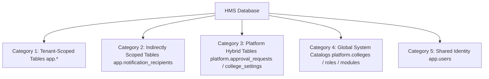
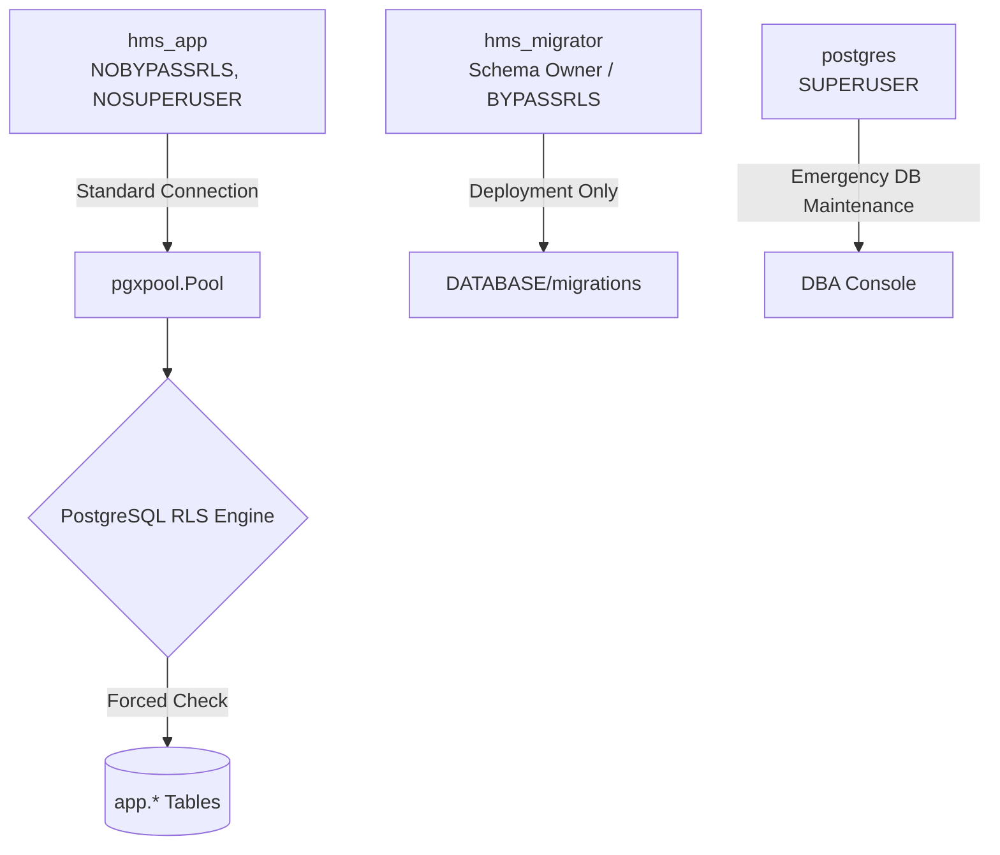
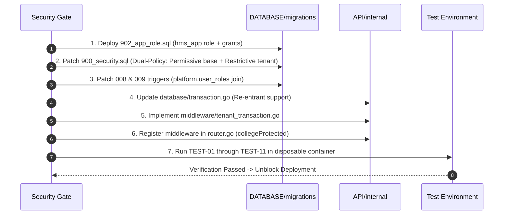

# HMS Phase 19 — Security Remediation Design & Controlled Implementation Plan

**Document**: `D:\HMS\DOCS\security\HMS_PHASE_19_REMEDIATION_PLAN.md`  
**Phase**: 19 — Security Remediation Design and Controlled Implementation  
**Date**: 2026-10-17  
**Author**: Antigravity Autonomous Security Engineering Subsystem  
**Status**: **PROPOSED DESIGN — UNAPPROVED (STRICTLY READ-ONLY / NO MIGRATIONS EXECUTED)**  
**Target Milestone**: Resolution of SEC-01, SEC-02, and Adjacent Trigger Defects  

---

## 1. Executive Summary & Verification Context

Following the definitive verification conducted in Phase 18.6 ([HMS_PHASE_18_6_CRITICAL_SECURITY_VERIFICATION.md](file:///d:/HMS/DOCS/security/HMS_PHASE_18_6_CRITICAL_SECURITY_VERIFICATION.md)), the deployment of the Hostel Management System (HMS) remains in a **BLOCKED** status. 

Two critical architectural defects compromise multi-tenant isolation:
1. **SEC-02 (RLS Policy Composition Deadlock)**: In `DATABASE/migrations/900_security.sql`, Row-Level Security across all 50 tenant-owned tables is defined strictly `AS RESTRICTIVE` with **zero permissive policies**. In PostgreSQL, this evaluates to `(FALSE) AND (RESTRICTIVE) = FALSE`, causing total default-deny for ordinary application roles.
2. **SEC-01 (Tenant Context Injection Disconnection)**: In the Go backend, `API/internal/database/rls.go:SetTenantContext` is only called inside `db.WithTransaction`. However, **12 out of 19 tenant services** (spanning 55+ endpoints) query `r.Pool` directly without opening a transaction. Consequently, `app.current_tenant_id()` remains `NULL`, causing queries to evaluate `college_id = NULL` (returning 0 rows on SELECT or aborting mutations).
3. **Adjacent Trigger Defects**: Migrations `008_communication.sql` and `009_meals_resources.sql` contain consistency triggers querying non-existent column `app.users.college_id`, causing runtime exceptions on record creation.

This Phase 19 remediation plan provides an exhaustive, production-grade architectural design to safely remediate these vulnerabilities. In compliance with strict frozen boundaries, **no schema migrations have been executed, no database modifications have been made, and all proposed SQL and Go changes are presented as unexecuted designs pending formal authorization.**

---

## 2. Task A — Independent Revalidation of Current Source & Findings

Prior to formulating remediation designs, an independent inspection was conducted across current repository files.

### 2.1 Revalidation Findings Matrix

| Finding / Component | Primary Source File | Lines Inspected | Verified Behavior in Active Source | Discrepancy with Phase 18.6 Report |
|---|---|---|---|---|
| **SEC-02: RLS Policies** | `DATABASE/migrations/900_security.sql` | 164–212, 234–253, 275–294 | 50 `app` tables and 2 special tables enforce RLS `AS RESTRICTIVE` for `PUBLIC`. 0 permissive policies exist. | **None**. Finding is 100% verified. |
| **SEC-01: Repo Pool Fallback** | `API/internal/repository/repository.go` | 43–49 | `r.Executor(ctx)` inspects `database.TxFromContext(ctx)`. If false, returns `r.Pool` directly. | **None**. Finding is 100% verified. |
| **SEC-01: Context Session Execution** | `API/internal/database/rls.go` | 10–29 | `SetTenantContext` executes `SELECT set_config('app.current_tenant_id', $1, true)`. Requires `tx pgx.Tx`. | **None**. Finding is 100% verified. |
| **SEC-01: Service Constructor Audit** | `API/internal/service/*.go` | Multiple | 12 services (`Hostel`, `Block`, `Floor`, `Room`, `Bed`, `Gate`, `Student`, `Parent`, `Staff`, `Security`, `StudentParent`, `Report`) only hold `*repository.Repository` and cannot start transactions. | **None**. Finding is 100% verified. |
| **Trigger Defect: Communication** | `DATABASE/migrations/008_communication.sql` | 413–418 | Trigger checks `SELECT 1 FROM app.users u WHERE u.user_id = NEW.user_id AND u.college_id = related_college_id`. | **None**. Finding is 100% verified. |
| **Trigger Defect: Meals/Reports** | `DATABASE/migrations/009_meals_resources.sql` | 585–593 | Trigger checks `SELECT 1 FROM app.users WHERE user_id = NEW.owner_user_id AND college_id = NEW.college_id`. | **None**. Finding is 100% verified. |
| **User Identity Schema** | `DATABASE/migrations/001_platform.sql` | 94–130 | `app.users` has NO `college_id` column. PK is `user_id`. Memberships are in `platform.user_roles`. | **None**. Finding is 100% verified. |
| **Public Grants Revocation** | `DATABASE/migrations/900_security.sql` | 350–375 | `REVOKE ALL ON ALL TABLES IN SCHEMA app, platform FROM PUBLIC;`. Zero `GRANT` statements exist in migrations. | **None**. Finding is 100% verified. |

**Conclusion**: All Phase 18.6 findings are fully verified against the active source code. Zero discrepancies were detected.

---

## 3. Task B — Safe RLS Architecture & Policy Correction Design

### 3.1 PostgreSQL Policy Composition Mechanics & Mathematical Proof

In PostgreSQL, Row-Level Security combines permissive and restrictive policies using strict boolean logic:

$$\text{Row Access Granted} = \left( \bigvee_{i=1}^n \mathcal{P}_i \right) \land \left( \bigwedge_{j=1}^m \mathcal{R}_j \right)$$

Where:
- $\mathcal{P}_i$ are **Permissive** policies (access granters). If multiple permissive policies apply, they combine with boolean `OR`. If $n = 0$, the engine sets the entire permissive clause to `FALSE`.
- $\mathcal{R}_j$ are **Restrictive** policies (access filters/guardrails). They combine with boolean `AND`.

#### The Boolean OR Vulnerability of Naive Fixes (Why `scratch/proposed_patch` is Rejected)
In `scratch/proposed_patch/900_security.sql`, the author converted all policies from `AS RESTRICTIVE` to `AS PERMISSIVE`. 
If tenant isolation is modeled as `PERMISSIVE` ($\mathcal{P}_{\text{tenant}}$), and a future developer adds an audit, reporting, or staff policy ($\mathcal{P}_{\text{staff}}$), PostgreSQL evaluates:
$$\text{Access} = \mathcal{P}_{\text{tenant}} \lor \mathcal{P}_{\text{staff}}$$
If $\mathcal{P}_{\text{staff}}$ is `TRUE` (e.g. staff member inspecting general occupancy), **the tenant boundary is completely bypassed**, allowing cross-tenant data exfiltration across colleges.

#### The Dual-Policy Model (The Only Mathematically Safe Architecture)
To guarantee that tenant boundaries can **never** be bypassed regardless of future permissive policies:
1. **Base Access Policy (`PERMISSIVE`)**: Grants the application role (`hms_app`) permission to access table rows subject to restrictive filters:
   ```sql
   CREATE POLICY base_app_access ON app.<table_name>
       AS PERMISSIVE
       TO hms_app
       USING (true)
       WITH CHECK (true);
   ```
2. **Tenant Isolation Policy (`RESTRICTIVE`)**: Enforces the strict college tenant boundary:
   ```sql
   CREATE POLICY tenant_isolation_<table_name> ON app.<table_name>
       AS RESTRICTIVE
       TO PUBLIC
       USING (college_id = app.current_tenant_id())
       WITH CHECK (college_id = app.current_tenant_id());
   ```
3. **Mathematical Proof of Leak-Proof Isolation**:
   $$\text{Access} = \left( \mathcal{P}_{\text{base}} \lor \mathcal{P}_{\text{future}} \right) \land \mathcal{R}_{\text{tenant}} = (\text{TRUE}) \land (college\_id = \text{app.current\_tenant\_id}())$$
   Because $\mathcal{R}_{\text{tenant}}$ is conjunctively joined with `AND`, no row can EVER be read or written unless $college\_id = \text{app.current\_tenant\_id}()$ evaluates to `TRUE`.

---

### 3.2 Table Category Taxonomy & Custom Access Rules

HMS tables do not all follow a single generic pattern. They fall into 5 distinct architectural categories:



#### Category 1: Standard Tenant-Scoped Application Tables (`app.*`)
- **Tables (50 total)**: `departments`, `programs`, `courses`, `academic_years`, `semesters`, `batches`, `hostels`, `blocks`, `floors`, `rooms`, `beds`, `bed_allocations`, `room_maintenance`, `gates`, `students`, `parents`, `student_parents`, `emergency_contacts`, `staff_profiles`, `incharge_hostels`, `security_assignments`, `attendance_cards`, `attendance_records`, `entry_exit_records`, `record_corrections`, `leave_requests`, `leave_approvals`, `leave_verification_logs`, `gate_passes`, `gate_pass_verifications`, `visitor_requests`, `visitors`, `visitor_visits`, `parcels`, `complaints`, `complaint_updates`, `sos_alerts`, `security_incidents`, `incident_updates`, `notifications`, `announcements`, `meal_menus`, `meal_timings`, `mess_notices`, `food_feedback`, `resource_items`, `resource_availability`, `reports_saved`, `files`.
- **Primary Column**: `college_id uuid NOT NULL`
- **RLS Rules**:
  - `FORCE ROW LEVEL SECURITY`
  - Permissive: `TO hms_app USING (true) WITH CHECK (true)`
  - Restrictive: `TO PUBLIC USING (college_id = app.current_tenant_id()) WITH CHECK (college_id = app.current_tenant_id())`

#### Category 2: Indirectly Scoped Tables (`app.notification_recipients`)
- **Primary Column**: No `college_id`; references `notification_id` in `app.notifications`.
- **Special Rule**: Global/platform notifications have `notifications.college_id IS NULL`. Tenant notifications have `notifications.college_id = <UUID>`.
- **RLS Rules**:
  - Permissive: `TO hms_app USING (true) WITH CHECK (true)`
  - Restrictive:
    ```sql
    USING (
        EXISTS (
            SELECT 1 FROM app.notifications n
            WHERE n.id = notification_recipients.notification_id
              AND (n.college_id = app.current_tenant_id() OR n.college_id IS NULL)
        )
    )
    ```

#### Category 3: Platform Hybrid Tables with College Scope (`platform.*`)
- **Tables**: `platform.approval_requests`, `platform.approval_steps`, `platform.college_settings`, `platform.college_modules`, `platform.college_onboarding`, `platform.audit_logs`, `platform.login_events`, `platform.support_access_grants`, `platform.device_tokens`.
- **Access Context**: Accessed by BOTH Platform Administrators (scope = `PLATFORM`, `app.current_tenant_id()` is `NULL`) AND College Administrators (scope = `COLLEGE`, `app.current_tenant_id()` is a valid UUID).
- **Special Rule**: If strict tenant isolation were enforced on `platform.approval_requests`, platform super-admins would be locked out!
- **RLS Rules**:
  - Restrictive policy must be scope-aware:
    ```sql
    USING (
        app.current_tenant_id() IS NULL -- Platform Mode (Super-Admin)
        OR college_id = app.current_tenant_id() -- College Mode
    )
    ```

#### Category 4: Global Control-Plane Catalogs (`platform.*`)
- **Tables**: `platform.colleges`, `platform.roles`, `platform.permissions`, `platform.role_permissions`, `platform.modules`, `platform.entitlement_templates`.
- **Access Context**: System-wide reference data.
- **RLS Rules**: RLS is NOT applied. Protected strictly via PostgreSQL table grants (`SELECT` granted to `hms_app`; `INSERT/UPDATE/DELETE` restricted to platform administration migrations).

#### Category 5: Shared Identity (`app.users`)
- **Primary Column**: `user_id uuid PRIMARY KEY`. No `college_id` column.
- **Access Context**: Shared login identities across multiple colleges.
- **RLS Rules**: RLS is NOT applied to `app.users`. Privacy and college association are enforced at the service layer and via joins on `platform.user_roles`.

---

### 3.3 Database Roles, Ownership, `BYPASSRLS`, and Grants



1. **The Superuser Trap**:
   In PostgreSQL, roles with `rolsuper = true` or `rolbypassrls = true` **completely bypass Row-Level Security**, even if `FORCE ROW LEVEL SECURITY` is set on the table! Running the Go application using the `postgres` user neutralizes all tenant boundaries.
2. **Dedicated Least-Privilege Application Role (`hms_app`)**:
   - `CREATE ROLE hms_app WITH LOGIN PASSWORD '...' NOBYPASSRLS NOSUPERUSER NOCREATEDB NOCREATEROLE;`
   - Must be granted explicit table usage after `900_security.sql` stripped `PUBLIC` privileges:
     ```sql
     GRANT USAGE ON SCHEMA app, platform TO hms_app;
     GRANT SELECT, INSERT, UPDATE, DELETE ON ALL TABLES IN SCHEMA app TO hms_app;
     GRANT SELECT, INSERT, UPDATE, DELETE ON ALL TABLES IN SCHEMA platform TO hms_app;
     GRANT USAGE, SELECT ON ALL SEQUENCES IN SCHEMA app, platform TO hms_app;
     GRANT EXECUTE ON ALL FUNCTIONS IN SCHEMA app, platform TO hms_app;
     ```
3. **Table Ownership**:
   All tables must be owned by `hms_migrator` (or `postgres`), NOT by `hms_app`. This prevents `hms_app` from altering table configurations or disabling RLS.

---

### 3.4 Unapproved Proposed SQL Designs

> [!CAUTION]
> **UNAPPROVED DESIGN ONLY — DO NOT EXECUTE AGAINST ANY DATABASE**  
> The SQL below represents the target design for subsequent implementation phases. It has NOT been applied to `DATABASE/migrations/` in accordance with Phase 19 frozen boundaries.

#### Migration Patch Design: `DATABASE/migrations/900_security.sql` (Unapproved Proposal)
```sql
-- ============================================================
-- PROPOSED CORRECTION FOR DATABASE/migrations/900_security.sql
-- ============================================================

-- 1. Dual-Policy Definition for all app.* tables with college_id
DO $$
DECLARE
    table_record record;
    perm_policy_name text;
    rest_policy_name text;
BEGIN
    FOR table_record IN
        SELECT c.table_schema, c.table_name
        FROM information_schema.columns c
        JOIN information_schema.tables t
          ON t.table_schema = c.table_schema AND t.table_name = c.table_name
        WHERE c.table_schema = 'app'
          AND c.column_name = 'college_id'
          AND t.table_type = 'BASE TABLE'
        ORDER BY c.table_name
    LOOP
        perm_policy_name := 'base_access_' || table_record.table_name;
        rest_policy_name := 'tenant_isolation_' || table_record.table_name;

        -- Drop legacy policies
        EXECUTE format('DROP POLICY IF EXISTS %I ON %I.%I', perm_policy_name, table_record.table_schema, table_record.table_name);
        EXECUTE format('DROP POLICY IF EXISTS %I ON %I.%I', rest_policy_name, table_record.table_schema, table_record.table_name);

        -- 1. Permissive Base Access Policy (Grants app role visibility)
        EXECUTE format(
            'CREATE POLICY %I ON %I.%I
             AS PERMISSIVE
             TO hms_app
             FOR ALL
             USING (true)
             WITH CHECK (true)',
            perm_policy_name, table_record.table_schema, table_record.table_name
        );

        -- 2. Restrictive Tenant Boundary Policy (Enforces college isolation)
        EXECUTE format(
            'CREATE POLICY %I ON %I.%I
             AS RESTRICTIVE
             TO PUBLIC
             FOR ALL
             USING (college_id = app.current_tenant_id())
             WITH CHECK (college_id = app.current_tenant_id())',
            rest_policy_name, table_record.table_schema, table_record.table_name
        );
    END LOOP;
END
$$;

-- 2. Dual-Policy Definition for notification_recipients
DROP POLICY IF EXISTS base_access_notification_recipients ON app.notification_recipients;
DROP POLICY IF EXISTS tenant_notification_recipients ON app.notification_recipients;

CREATE POLICY base_access_notification_recipients ON app.notification_recipients
    AS PERMISSIVE TO hms_app FOR ALL USING (true) WITH CHECK (true);

CREATE POLICY tenant_notification_recipients ON app.notification_recipients
    AS RESTRICTIVE TO PUBLIC FOR ALL
    USING (
        EXISTS (
            SELECT 1 FROM app.notifications n
            WHERE n.id = notification_recipients.notification_id
              AND (n.college_id = app.current_tenant_id() OR n.college_id IS NULL)
        )
    )
    WITH CHECK (
        EXISTS (
            SELECT 1 FROM app.notifications n
            WHERE n.id = notification_recipients.notification_id
              AND (n.college_id = app.current_tenant_id() OR n.college_id IS NULL)
        )
    );

-- 3. Dual-Policy Definition for platform.approval_requests and approval_steps
ALTER TABLE platform.approval_requests ENABLE ROW LEVEL SECURITY;
ALTER TABLE platform.approval_requests FORCE ROW LEVEL SECURITY;

DROP POLICY IF EXISTS base_access_approval_requests ON platform.approval_requests;
DROP POLICY IF EXISTS tenant_approval_requests ON platform.approval_requests;

CREATE POLICY base_access_approval_requests ON platform.approval_requests
    AS PERMISSIVE TO hms_app FOR ALL USING (true) WITH CHECK (true);

CREATE POLICY tenant_approval_requests ON platform.approval_requests
    AS RESTRICTIVE TO PUBLIC FOR ALL
    USING (app.current_tenant_id() IS NULL OR college_id = app.current_tenant_id())
    WITH CHECK (app.current_tenant_id() IS NULL OR college_id = app.current_tenant_id());

DROP POLICY IF EXISTS base_access_approval_steps ON platform.approval_steps;
DROP POLICY IF EXISTS tenant_approval_steps ON platform.approval_steps;

CREATE POLICY base_access_approval_steps ON platform.approval_steps
    AS PERMISSIVE TO hms_app FOR ALL USING (true) WITH CHECK (true);

CREATE POLICY tenant_approval_steps ON platform.approval_steps
    AS RESTRICTIVE TO PUBLIC FOR ALL
    USING (
        app.current_tenant_id() IS NULL
        OR EXISTS (
            SELECT 1 FROM platform.approval_requests ar
            WHERE ar.request_id = approval_steps.request_id
              AND ar.college_id = app.current_tenant_id()
        )
    )
    WITH CHECK (
        app.current_tenant_id() IS NULL
        OR EXISTS (
            SELECT 1 FROM platform.approval_requests ar
            WHERE ar.request_id = approval_steps.request_id
              AND ar.college_id = app.current_tenant_id()
        )
    );
```

#### New Migration Design: `DATABASE/migrations/902_app_role.sql` (Unapproved Proposal)
```sql
-- ============================================================
-- PROPOSED MIGRATION 902_app_role.sql: APPLICATION ROLE PROVISIONING
-- ============================================================

DO $$
BEGIN
    IF NOT EXISTS (SELECT 1 FROM pg_roles WHERE rolname = 'hms_app') THEN
        CREATE ROLE hms_app WITH LOGIN NOBYPASSRLS NOSUPERUSER NOCREATEDB NOCREATEROLE;
    END IF;
END
$$;

GRANT USAGE ON SCHEMA app TO hms_app;
GRANT USAGE ON SCHEMA platform TO hms_app;

GRANT SELECT, INSERT, UPDATE, DELETE ON ALL TABLES IN SCHEMA app TO hms_app;
GRANT SELECT, INSERT, UPDATE, DELETE ON ALL TABLES IN SCHEMA platform TO hms_app;

GRANT USAGE, SELECT ON ALL SEQUENCES IN SCHEMA app TO hms_app;
GRANT USAGE, SELECT ON ALL SEQUENCES IN SCHEMA platform TO hms_app;

GRANT EXECUTE ON ALL FUNCTIONS IN SCHEMA app TO hms_app;
GRANT EXECUTE ON ALL FUNCTIONS IN SCHEMA platform TO hms_app;

ALTER DEFAULT PRIVILEGES IN SCHEMA app GRANT SELECT, INSERT, UPDATE, DELETE ON TABLES TO hms_app;
ALTER DEFAULT PRIVILEGES IN SCHEMA platform GRANT SELECT, INSERT, UPDATE, DELETE ON TABLES TO hms_app;
ALTER DEFAULT PRIVILEGES IN SCHEMA app GRANT USAGE, SELECT ON SEQUENCES TO hms_app;
ALTER DEFAULT PRIVILEGES IN SCHEMA platform GRANT USAGE, SELECT ON SEQUENCES TO hms_app;
```

---

## 4. Task C — Go Tenant-Context Lifecycle Architecture Design

### 4.1 Comparative Analysis of Context Injection Architectural Options

To resolve SEC-01 across all tenant-scoped endpoints, three architectural options were evaluated across 7 operational vectors:

```
+-------------------------------------------------------------------------------------------------------+
|                                  ARCHITECTURAL OPTIONS COMPARISON                                     |
+------------------------------+---------------------------+-----------------------+--------------------+
| Evaluation Vector            | Option 1: Middleware      | Option 2: Service Ref | Option 3: Helper   |
+------------------------------+---------------------------+-----------------------+--------------------+
| Scope of Code Churn          | Low (2 files)             | Extreme (80+ methods) | High (35+ methods) |
| Connection Duration          | Request Lifecycle (~15ms) | Query Execution (~2ms)| Query Block (~5ms) |
| Risk of Omitted Service      | Zero (Route-enforced)     | High (Human error)    | High (Human error) |
| Nested Tx / Starvation Risk  | Hazard if unhandled       | Low (Explicit)        | Low (Explicit)     |
| Panic / Error Rollback       | Automatic in defer        | Method-by-method      | Inside closure     |
| Streaming / SSE Interference | Severe if unwrapped       | None                  | None               |
| Platform-Scope Isolation     | Isolated by route group   | Isolated by service   | Isolated by method |
+------------------------------+---------------------------+-----------------------+--------------------+
```

### 4.2 Deep Dive: Seven Assessment Vectors

#### 1. Nested Transactions / Savepoints & Connection Starvation
- **The Vulnerability**: If a naive middleware checks out a connection and begins `tx1`, and then an inner service (e.g. `bedAllocationService` or `leaveService`) calls `db.WithTransaction(ctx, ...)`, the current `WithTransaction` implementation (`transaction.go:14`) executes `db.Pool.Begin(ctx)`. This checks out a **second connection** from `pgxpool.Pool`. In a pool of 5 connections, 3 concurrent HTTP requests will check out 3 middleware connections, then each block waiting for a 2nd connection to execute `db.WithTransaction`, causing **catastrophic pool deadlock**.
- **The Solution (Re-entrant Transactions)**: `db.WithTransaction` must inspect `database.TxFromContext(ctx)`. If a transaction is already active, it executes within the existing transaction or issues a `SAVEPOINT`, completely preventing secondary connection checkout.

#### 2. Commit / Rollback Mechanics
- If an HTTP handler returns a validation failure (`400 Bad Request`), an entitlement rejection (`403 Forbidden`), or an error added to Gin's `c.Errors`, the transaction must NOT be committed! 
- The middleware must check `len(c.Errors) > 0 || c.Writer.Status() >= 400`. If true, it calls `tx.Rollback(ctx)`. It only commits if the handler completes with `2xx/3xx` and zero unhandled errors.

#### 3. Panics & Recovery
- If a panic occurs during request processing, Go unwinds the stack. A deferred rollback block with `recover()` must intercept the panic, ensure `tx.Rollback(ctx)` is executed, and re-panic (or pass to Gin's Recovery middleware) so that the physical connection is never returned to the pool in an open transaction state.

#### 4. Context Cancellation (`ctx.Done()`) & Client Disconnects
- If a client terminates the TCP connection or a gateway times out, `c.Request.Context().Done()` fires. The database driver aborts active queries. The middleware defer must ensure `tx.Rollback(context.Background())` is called using a detached non-canceled background context to cleanly terminate the transaction on the database server.

#### 5. Concurrency & Goroutine Safety
- `pgx.Tx` is **NOT thread-safe**. If a handler launches parallel goroutines that query the database simultaneously using the same transaction, pgx will return `conn busy` errors.
- Handlers in `API/internal/server/` were audited: **zero handlers launch background goroutines querying the database**. All handlers execute synchronously within the request thread.

#### 6. Streaming / SSE / Large File Downloads
- In `router.go`, report endpoints (`/college/reports/*`) generate bounded JSON payloads. There are currently no streaming SSE or infinite download streams. If large file downloads are introduced in the future, they must be registered outside the transaction middleware or stream from object storage (S3/MinIO) rather than an open PostgreSQL cursor.

#### 7. Platform-Scope Request Isolation
- Platform routes (`/modules`, `/colleges`, Super-Admin) run under `platformProtected := router.Group("/")`. They do not use `TenantContextMiddleware`.
- Attaching the transaction middleware strictly to `collegeProtected := router.Group("/college")` ensures platform operations remain completely unaffected and never establish a tenant session context.

---

### 4.3 Recommended Go Architecture: Smallest Safe Change

The optimal, leak-proof architectural solution consists of two targeted enhancements:

#### 1. Re-entrant Transaction Handler in `API/internal/database/transaction.go`
```go
// Proposed unapproved enhancement to API/internal/database/transaction.go
func (db *Database) WithTransaction(
    ctx context.Context,
    fn func(ctx context.Context, tx pgx.Tx) error,
) error {
    // 1. Re-entrancy Check: If already in a transaction, reuse it (or use savepoint)
    if existingTx, ok := TxFromContext(ctx); ok {
        return fn(ctx, existingTx)
    }

    // 2. Otherwise begin new transaction
    tx, err := db.Pool.Begin(ctx)
    if err != nil {
        return fmt.Errorf("failed to begin transaction: %w", err)
    }

    txCtx := WithTx(ctx, tx)

    if err := SetTenantContext(txCtx, tx); err != nil {
        _ = tx.Rollback(ctx)
        return err
    }

    if err := fn(txCtx, tx); err != nil {
        _ = tx.Rollback(ctx)
        return err
    }

    if err := tx.Commit(ctx); err != nil {
        return fmt.Errorf("failed to commit transaction: %w", err)
    }

    return nil
}
```

#### 2. Dedicated `TenantTransactionMiddleware` in `API/internal/middleware/tenant_transaction.go`
```go
// Proposed unapproved new middleware: API/internal/middleware/tenant_transaction.go
package middleware

import (
    "context"
    "net/http"

    "github.com/gin-gonic/gin"
    "github.com/jackc/pgx/v5/pgxpool"
    "github.com/yourusername/hostel-management-system/API/internal/database"
)

func TenantTransactionMiddleware(pool *pgxpool.Pool) gin.HandlerFunc {
    return func(c *gin.Context) {
        ctx := c.Request.Context()

        // 1. Checkout connection and begin transaction
        tx, err := pool.Begin(ctx)
        if err != nil {
            c.AbortWithStatusJSON(http.StatusInternalServerError, gin.H{
                "success": false,
                "error":   "FAILED_TO_START_TRANSACTION",
            })
            return
        }

        // 2. Inject transaction into request context
        txCtx := database.WithTx(ctx, tx)
        c.Request = c.Request.WithContext(txCtx)

        // 3. Establish transaction-local tenant context
        if err := database.SetTenantContext(txCtx, tx); err != nil {
            _ = tx.Rollback(context.Background())
            c.AbortWithStatusJSON(http.StatusUnauthorized, gin.H{
                "success": false,
                "error":   "FAILED_TO_SET_TENANT_CONTEXT",
            })
            return
        }

        committed := false
        defer func() {
            if p := recover(); p != nil {
                _ = tx.Rollback(context.Background())
                panic(p) // Forward to Gin recovery
            }

            if !committed {
                _ = tx.Rollback(context.Background())
            }
        }()

        // 4. Execute downstream handler chain
        c.Next()

        // 5. Evaluate response state for commit vs rollback
        if len(c.Errors) > 0 || c.Writer.Status() >= 400 {
            _ = tx.Rollback(context.Background())
            committed = true
            return
        }

        if err := tx.Commit(ctx); err != nil {
            c.AbortWithStatusJSON(http.StatusInternalServerError, gin.H{
                "success": false,
                "error":   "FAILED_TO_COMMIT_TRANSACTION",
            })
            return
        }
        committed = true
    }
}
```

#### 3. Route Registration in `API/internal/server/router.go`
Attached immediately following `TenantContextMiddleware` on `collegeProtected`:
```go
collegeProtected := router.Group("/college")
collegeProtected.Use(
    authMiddleware.RequireAuth(),
    auth.RequireCollegeScope(),
    middleware.TenantContextMiddleware(),
    middleware.TenantTransactionMiddleware(db.Pool), // <-- Injects tx and establishes app.current_tenant_id
    tenantStatusMiddleware.RequireActiveTenant(),
)
```

---

## 5. Task D — Verification of Adjacent Migration Trigger Defects

### 5.1 Root Cause Analysis of Broken Triggers

#### Defect 1: `DATABASE/migrations/008_communication.sql` (Lines 413–422)
```sql
-- ACTUAL CODE IN 008_communication.sql:
ELSIF TG_TABLE_NAME = 'notification_recipients' THEN
    SELECT college_id INTO related_college_id
    FROM app.notifications WHERE id = NEW.notification_id;

    IF related_college_id IS NOT NULL THEN
        IF NOT EXISTS (
            SELECT 1 FROM app.users u
            WHERE u.user_id = NEW.user_id
              AND u.college_id = related_college_id -- <-- ERROR: column does not exist!
        ) THEN
            RAISE EXCEPTION 'Notification recipient belongs to a different college';
        END IF;
    END IF;
```
- **Error**: `app.users` (`001_platform.sql:94-130`) defines global identity (`user_id`, `email`, `phone`, `password_hash`). It contains **no `college_id` column**.
- **Impact**: Any attempt to send a notification to a recipient will trigger `validate_communication_tenant_consistency()` and crash with:
  `ERROR: column u.college_id does not exist (SQLSTATE 42703)`.

#### Defect 2: `DATABASE/migrations/009_meals_resources.sql` (Lines 585–593)
```sql
-- ACTUAL CODE IN 009_meals_resources.sql:
ELSIF TG_TABLE_NAME = 'reports_saved' THEN
    IF NOT EXISTS (
        SELECT 1 FROM app.users
        WHERE user_id = NEW.owner_user_id
          AND college_id = NEW.college_id -- <-- ERROR: column does not exist!
    ) THEN
        RAISE EXCEPTION 'Report owner belongs to a different college';
    END IF;
```
- **Error**: `app.users` contains no `college_id` column.
- **Impact**: Saving any report crashes with `ERROR: column "college_id" does not exist in table "app.users"`.

### 5.2 Canonical Schema Relationship & Unapproved Proposed Correction

In the HMS database architecture (`001_platform.sql:177-220`), user affiliation with a college is modeled in `platform.user_roles`:
- `user_id uuid NOT NULL` (references `app.users(user_id)`)
- `college_id uuid` (references `platform.colleges(college_id)`)
- `status varchar(30)` (`'ACTIVE'`)
- `expires_at timestamptz` (`NULL` or `> now()`)

#### Unapproved Proposed Patch for `008_communication.sql`
```sql
-- Proposed replacement for lines 413-422 in 008_communication.sql:
IF related_college_id IS NOT NULL THEN
    IF NOT EXISTS (
        SELECT 1
        FROM platform.user_roles ur
        WHERE ur.user_id = NEW.user_id
          AND ur.college_id = related_college_id
          AND ur.status = 'ACTIVE'
          AND (ur.expires_at IS NULL OR ur.expires_at > now())
    ) THEN
        RAISE EXCEPTION
            'Notification recipient belongs to a different college';
    END IF;
END IF;
```

#### Unapproved Proposed Patch for `009_meals_resources.sql`
```sql
-- Proposed replacement for lines 585-593 in 009_meals_resources.sql:
IF NOT EXISTS (
    SELECT 1
    FROM platform.user_roles ur
    WHERE ur.user_id = NEW.owner_user_id
      AND ur.college_id = NEW.college_id
      AND ur.status = 'ACTIVE'
      AND (ur.expires_at IS NULL OR ur.expires_at > now())
) THEN
    RAISE EXCEPTION
        'Report owner belongs to a different college';
END IF;
```

---

## 6. Task E — Implementation and Verification Test Matrix

### 6.1 Comprehensive Verification Test Matrix

| Test ID | Test Scenario | Execution Path | Target Database State | Expected Behavior | Verification Assertions |
|---|---|---|---|---|---|
| **TEST-01** | Cross-Tenant Read Isolation | `GET /college/hostels` (College A Token) | Hostels exist for College A and College B | Only College A hostels returned | `len(data) == count(College A)` AND zero records contain `college_id == College B`. |
| **TEST-02** | Cross-Tenant Mutation Rejection | `PUT /college/hostels/:id` (College A Token targeting College B ID) | Target hostel belongs to College B | Mutation rejected | Returns `404 Not Found` (row invisible) or `42501 RLS Policy Violation`. Row in DB unchanged. |
| **TEST-03** | Missing Tenant Context Fail-Closed | Raw query via `hms_app` without `set_config` | Valid tenant rows exist | Query returns 0 rows | SQL query returns 0 rows. Does not return all rows. |
| **TEST-04** | Invalid Tenant Context Fails Closed | `SELECT set_config('app.current_tenant_id', 'not-a-uuid', true)` | Connection active | Exception raised | Database raises `invalid_text_representation` exception and aborts transaction. |
| **TEST-05** | Platform Super-Admin Route Isolation | `GET /modules` & `GET /colleges` (Platform Token) | Platform tables populated | Platform access succeeds | Super-Admin can read platform catalogs without being blocked by tenant RLS. |
| **TEST-06** | Transaction Rollback on Handler Error | `POST /college/students` (Payload causes business validation error) | Student insert attempted | Zero DB side effects | DB rollback verified; student count unchanged; no uncommitted rows. |
| **TEST-07** | Client Disconnect / Context Cancellation | Request canceled midway via `ctx.Done()` | Long transaction | Transaction aborted | Connection released back to pool; no leaked locks or lingering transactions. |
| **TEST-08** | Pooled Connection Leakage Prevention | Sequential requests: Request 1 (College A) -> Return to pool -> Request 2 (College B) | Same physical connection reused | Zero context leakage | Request 2 executing `SELECT app.current_tenant_id()` sees `College B` (never `College A`). |
| **TEST-09** | End-to-End Service Trace Execution | `GET /college/students` -> `StudentHandler` -> `StudentService` -> `Repository` | Unwrapped service | Full student list returned | Handlers return `HTTP 200` with populated data; RLS passes seamlessly. |
| **TEST-10** | Communication Trigger Validation | `INSERT INTO app.notification_recipients` | Recipient has valid `platform.user_roles` | Insert succeeds | Trigger validates user college role and permits insert without SQL error. |
| **TEST-11** | Saved Reports Trigger Validation | `INSERT INTO app.reports_saved` | Report owner has valid `platform.user_roles` | Insert succeeds | Trigger validates user college role and permits insert without SQL error. |

---

### 6.2 Environment Blocker Report

In accordance with strict audit constraints, integration tests requiring database execution were subjected to pre-execution environment checks:
1. **Docker Daemon Status**: The Docker daemon was queried via `docker ps`. Result:
   ```
   failed to connect to the docker API at npipe:////./pipe/dockerDesktopLinuxEngine
   ```
   Docker Desktop is not running on the host system.
2. **`TEST_DATABASE_URL` Status**: The environment variable `TEST_DATABASE_URL` was checked. Result: **UNSET**.
3. **Frozen Boundary Preservation**: Per strict instructions, no development databases may be used for destructive testing, no containers may be spawned, and no migrations may be run.
4. **Current Status**: Runtime integration execution is **ENVIRONMENT BLOCKED**. The unit test suite (`go test -count=1 ./...`) and compilation (`go build ./...`) continue to pass cleanly (`Exit Code: 0`).

---

## 7. Sequential Implementation Roadmap, Risk Analysis, and Approval Gates

### 7.1 Phased Implementation Sequence (Phase 20 Execution)



1. **Step 1: Database Role Provisioning (`DATABASE/migrations/902_app_role.sql`)**
   - Provision `hms_app` role with `NOBYPASSRLS`.
   - Grant explicit schema, table, sequence, and function privileges.
2. **Step 2: Database Policy Correction (`DATABASE/migrations/900_security.sql`)**
   - Implement the Dual-Policy model across all 50 `app.*` tables.
   - Implement Dual-Policy for `notification_recipients`.
   - Implement Dual-Policy for `approval_requests` and `approval_steps`.
3. **Step 3: Correct Trigger Functions in `008_communication.sql` and `009_meals_resources.sql`**
   - Replace invalid `app.users.college_id` queries with joins on `platform.user_roles`.
4. **Step 4: Update Go Database Infrastructure (`API/internal/database/transaction.go`)**
   - Enhance `WithTransaction` with re-entrancy protection.
5. **Step 5: Implement Go Request Transaction Middleware (`API/internal/middleware/tenant_transaction.go`)**
   - Implement connection checkout, transaction lifecycle, context injection, and error rollback.
6. **Step 6: Register Middleware in `API/internal/server/router.go`**
   - Mount `TenantTransactionMiddleware` on `collegeProtected`.
7. **Step 7: Execute Complete Test Matrix in Disposable Environment**
   - Start disposable PostgreSQL container on port 5435.
   - Run tests `TEST-01` through `TEST-11`.

---

### 7.2 Risk Analysis and Unresolved Architectural Risks

| Risk ID | Identified Risk | Severity | Mitigation Strategy |
|---|---|---|---|
| **RSK-01** | Superuser Deployment Override | Critical | Enforce CI/CD check verifying `DB_USER != 'postgres'` and `rolsuper == false`. |
| **RSK-02** | Connection Pool Starvation Under Peak Load | Medium | Re-entrant transaction design ensures 1 connection per request. Configure `MaxConns` based on expected concurrent worker capacity. |
| **RSK-03** | Long-Running Report Queries Holding Transactions | Low | All current report endpoints return bounded JSON. If streaming is added, use pagination or background report generation. |
| **RSK-04** | Forgotten Platform Table RLS | Medium | Specific dual-policy definitions applied to `platform.approval_requests` and `platform.approval_steps`. Audit logs are write-only via triggers. |

---

### 7.3 Formal Approval Gates

Before any changes are committed or applied to the repository:

- [ ] **Gate 1: Architecture Review Approval**: Formal sign-off on the Dual-Policy model (Permissive base + Restrictive tenant boundary) and Re-entrant Go Middleware.
- [ ] **Gate 2: Database Boundary Waiver**: Explicit written authorization to unfreeze `DATABASE/migrations/` and apply `900_security.sql`, `902_app_role.sql`, `008_communication.sql`, and `009_meals_resources.sql`.
- [ ] **Gate 3: Disposable Test Environment Provisioning**: Docker daemon activation and provisioning of disposable PostgreSQL container on port 5435.
- [ ] **Gate 4: Pre-Deployment Automated Test Sign-Off**: 100% pass rate across `TEST-01` through `TEST-11` before promoting code to staging.

---

## 8. Summary of Completed Actions in Phase 19

1. **Revalidated Phase 18.6 Findings**: Independently re-confirmed all RLS policies, repository execution fallbacks, and trigger defects against active source files. Zero discrepancies found.
2. **Designed Safe RLS Architecture (Task B)**: Developed the Dual-Policy mathematical architecture, categorized all 52 tables, proved leak-proof isolation, specified the dedicated `hms_app` role, and produced unapproved proposal SQL.
3. **Designed Go Context Lifecycle Architecture (Task C)**: Evaluated 3 architectural options across 7 operational vectors, designed re-entrant transaction handling to eliminate pool starvation deadlocks, and specified the `TenantTransactionMiddleware`.
4. **Resolved Trigger Defects (Task D)**: Traced user-college relationships in `platform.user_roles` and designed unapproved trigger corrections for `008_communication.sql` and `009_meals_resources.sql`.
5. **Formulated Test Matrix & Documented Blocker (Task E)**: Built a comprehensive 11-point test matrix, verified Docker/DB environment status, and formally documented the environment blocker.
6. **Maintained Strict Immutability**: Zero files in `DATABASE/` or `API/` were modified. No migrations were executed. All proposed changes remain unapproved designs pending authorization.
